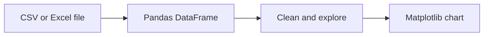
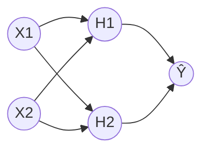
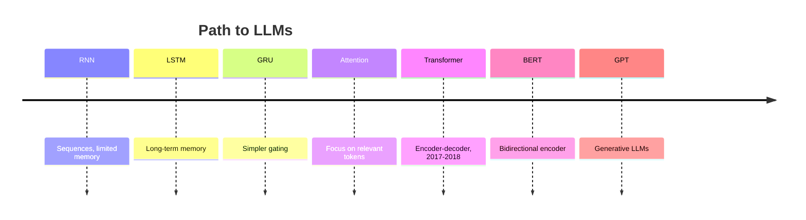
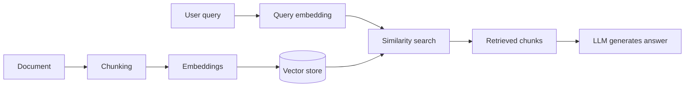
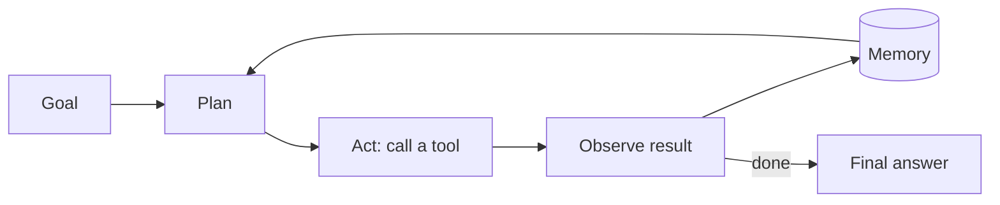
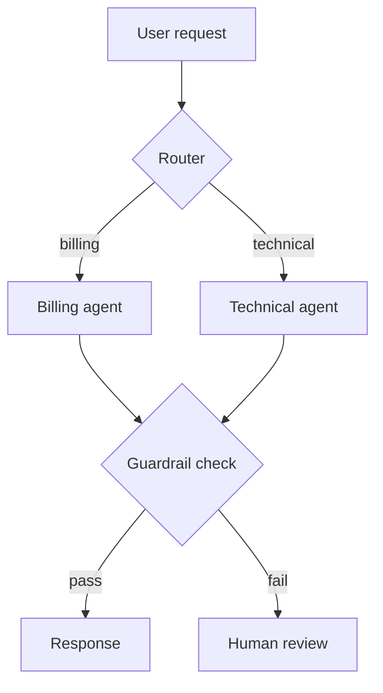

# AI Engineer Guide: Next Gen AI Cohort 4

This study guide follows the order of the course schedule. Each section covers one schedule block with:

- A plain-language explanation
- Key concepts and definitions
- A concrete example
- A diagram (Mermaid where it renders, otherwise ASCII)
- A link to the matching recap in [claude-files/](claude-files/), where one exists

**Source tags**
- **[Recap]**: taken from the session recaps in this repository
- **[Schedule]**: taken from the schedule topic text only
- **[General]**: general background knowledge, not from the course materials. Verify before relying on it.

---

## 1. Python Foundations (Prerequisite Refresher)

**Explanation.** Python is the main language for AI work. This block refreshes the basics needed for data work: data types, lists, dictionaries, functions, and the core libraries. [Schedule]

**Key concepts**
- **NumPy (Numerical Python):** fast arrays and math on numbers.
- **Pandas:** tables (DataFrames) for reading and cleaning CSV and Excel data.
- **Matplotlib:** plotting, such as bar and line charts.
- **`value_counts()`:** counts how often each category appears in a column.
- **`describe()`:** summary statistics (mean, standard deviation, quartiles) for numeric columns.

**Example.** Load a loan dataset and count approved vs. rejected applications:

```python
import pandas as pd
data = pd.read_csv("loan_approval_prediction.csv")
print(data["Loan_Status"].value_counts())   # e.g. Y: 411, N: 187
```

**Diagram** (data flow in the analysis step)



**Recap:** [recap-2026-10-14.md](claude-files/recap-2026-10-14.md)

---

## 2. Intro to Machine Learning (ML) and Deep Learning (DL)

**Explanation.** ML learns patterns from data to make predictions. DL is a part of ML that uses multi-layer neural networks. The schedule covers ML types, the train/validation/test split, overfitting, neural networks, backpropagation, and activation functions. [Schedule]

**Key concepts**
- **Supervised learning:** learns from labeled data (inputs plus a known output). Example: loan approved or rejected. [Recap]
- **Unsupervised learning:** finds structure in unlabeled data. Example: grouping customers into segments. [Recap]
- **Reinforcement learning:** an agent learns by acting in an environment and getting feedback. [Recap]
- **Train/test split:** most data trains the model; a held-out part measures how well it generalizes. An 80/20 split is common. [Recap]
- **Overfitting:** the model memorizes training data and performs poorly on new data. [General]
- **Neural network:** layers of neurons (input, hidden, output). Each connection has a weight. [Recap]
- **Forward propagation:** input passes through the network to produce a prediction. [Recap]
- **Backward propagation (backpropagation):** the error is sent back through the network to update the weights. Weight update: W_new = W_old − α × ∂Loss/∂W, where α is the learning rate. [Recap]
- **Epoch:** one forward pass plus one backward pass over the training data. [Recap]
- **Activation function:** a function applied to a neuron's output. Standard uses [General]: sigmoid for a binary-classification output layer, softmax for a multi-class output layer, tanh and ReLU (Rectified Linear Unit) in hidden layers, and a linear output for regression. Note: the 2026-10-28 recap records different placements (tanh for binary classification, ReLU for regression), and the recap's transcript appears garbled on this point. The standard explanation above is used instead. See [claude-files/recap-2026-10-28.md](claude-files/recap-2026-10-28.md).

**Example.** A logistic regression model on loan data reached about 84% accuracy on the test split. [Recap]

**Diagram** (neural network with one hidden layer)



**Recap:** [recap-2026-10-26.md](claude-files/recap-2026-10-26.md), [recap-2026-10-28.md](claude-files/recap-2026-10-28.md)

---

## 3. Deep Learning Architectures and Transformer Basics

**Explanation.** Different network types suit different data. CNNs handle images, RNNs and LSTMs handle sequences such as text, and the Transformer is the base architecture of current LLMs. [Recap] [Schedule]

**Key concepts**
- **CNN (Convolutional Neural Network):** uses filters (kernels) that slide over an image to detect features. Pooling (for example max pooling) shrinks the feature map. [Recap]
- **RNN (Recurrent Neural Network):** processes a sequence one step at a time, keeping a memory of earlier steps. It struggles with long sequences. [Recap]
- **LSTM (Long Short-Term Memory):** an RNN variant with gates that keep long-range information. [Recap]
- **Transformer:** an encoder-decoder architecture built around attention. [Recap]
- **Self-attention:** each token scores how relevant every other token is. [General]
- **Multi-head attention:** several attention computations in parallel, each focusing on different relationships. [General]
- **Positional encoding:** adds word-order information, since attention alone ignores order. [General]

**Example (CNN).** A 5 × 5 pixel grid convolved with a 3 × 3 filter gives a 3 × 3 output, using the formula Output = N − F + 1 = 5 − 3 + 1 = 3. [Recap]

**Diagram** (CNN pipeline)

```
Color image -> Grayscale -> Pixels (0-255) -> Normalize (0/1)
            -> Feature map -> Convolution (filter) -> Pooling -> Dense layers
```

**Recap:** [recap-2026-10-28.md](claude-files/recap-2026-10-28.md), [recap-2026-11-02.md](claude-files/recap-2026-11-02.md)

---

## 4. ML vs. DL and the Build-Up to LLMs (Phase 2A)

**Explanation.** This block compares ML and DL, and shows how neural networks led to LLMs. [Schedule]

**Key concepts**
- **ML:** works best on structured data, the rows-and-columns tables. [Recap]
- **DL:** works best on unstructured data such as images, audio, and text. [Recap]
- **Lineage:** RNN → LSTM → GRU (Gated Recurrent Unit) → attention → encoder-decoder → Transformer (2017–2018) → BERT (Bidirectional Encoder Representations from Transformers) and GPT (Generative Pre-trained Transformer). [Recap]
- **LLM (Large Language Model):** a Transformer-based model trained on very large text collections. [Recap]
- **Limits of models:** hallucination (confident but wrong output) and weak reasoning on some tasks. [Schedule]

**Example.** Structured loan data suits a logistic regression model. Customer feedback text suits a language model. [Recap]

**Diagram** (timeline)



**Recap:** [recap-2026-11-02.md](claude-files/recap-2026-11-02.md)

---

## 5. LLMs, Prompt Engineering, and Fine-Tuning (Phase 2B)

**Explanation.** This block covers how LLMs read text, how to prompt them well, and how to adapt them further. [Schedule]

**Key concepts**
- **Tokenization:** splitting text into tokens (word pieces) that the model reads. [General]
- **Embedding:** a numeric vector that represents a token or text. [Recap]
- **Context window:** the maximum amount of text the model can read in one request. [General]
- **Prompt components:** instruction, persona or role, context, output format, tone, and guardrails. [Recap]
- **Zero-shot prompting:** an instruction with no examples. Best for simple tasks. [Recap]
- **Few-shot prompting:** the instruction plus examples. Best when the task is subjective. [Recap]
- **Chain-of-thought prompting:** asks the model to reason in steps. Best for multi-step decisions. [Recap]
- **Fine-tuning:** further training of a model on specific data. Most costly of the three hallucination mitigations. [Recap]
- **PEFT (Parameter-Efficient Fine-Tuning):** tunes a small set of added parameters instead of the whole model. [General]
- **LoRA (Low-Rank Adaptation):** a PEFT method that adds small trainable low-rank matrices. [General]
- **QLoRA (Quantized LoRA):** LoRA on a model compressed to lower-precision numbers, which saves memory. [General]

**Example (few-shot).** To classify resumes as "strong", "potential", or "low" fit, include two or three labeled sample resumes in the prompt so the model learns what each label means. [Recap]

**Diagram** (prompt structure)

```
[Persona]  You are a senior customer care executive.
[Instruction] Write an email to the customer.
[Context]  The customer was charged twice this month.
[Guardrail] Do not promise a refund.
[Format]   Greeting, body, conclusion.
[Tone]     Empathetic.
```

**Recap:** [recap-2026-11-02.md](claude-files/recap-2026-11-02.md), [recap-2026-11-04.md](claude-files/recap-2026-11-04.md)

---

## 6. RAG Architecture: Fundamentals (Phase 3A)

**Explanation.** Retrieval-Augmented Generation (RAG) lets an LLM answer from your own documents. It retrieves relevant text first, then generates the answer from it. This reduces hallucination. [Recap]

**Key concepts**
- **Document loader:** reads PDF, web, or spreadsheet sources. [Recap]
- **Chunking:** splits text into pieces, often with some overlap. A typical setting is chunk size 1000 with overlap 100. [Recap]
- **Embedding:** converts each chunk into a vector. [Recap]
- **Vector store:** a database of vectors (for example FAISS, Pinecone, or Chroma). [Recap]
- **Retrieval:** finds the stored chunks most similar to the query. [Recap]
- **Generation:** the LLM writes the answer using the retrieved text. [Recap]
- **Lost in the middle:** models tend to miss facts placed in the middle of a long context. [Schedule]

**Example.** Loading a 9-page annual report, splitting it into 42 chunks, embedding them, and asking "What investments did the company make in AI?" retrieves the matching chunk, then the LLM answers from it. [Recap]

**Diagram** (ingestion and query flow)



**Recap:** [recap-2026-11-04.md](claude-files/recap-2026-11-04.md), [recap-2026-11-11.md](claude-files/recap-2026-11-11.md)

---

## 7. RAG Architecture: Advanced (Phase 3B)

**Explanation.** Basic RAG can return loosely relevant text. Advanced RAG improves retrieval and checks answer quality. [Schedule]

**Key concepts**
- **Hybrid retrieval:** combines keyword search (BM25) with vector search. [Recap]
- **BM25 (Best Matching 25):** a keyword-ranking method. Needed when exact terms matter, such as a GST number. [Recap]
- **Semantic search:** matches on meaning using vectors. [Recap]
- **Query rewriting:** rephrases the user's question before retrieval to match the documents better. [General]
- **Reranker:** a second model that re-orders retrieved results by relevance. [General]
- **Evaluation metrics:** retrieval hit rate (did the right chunk come back?), groundedness (is the answer supported by the sources?), and hallucination checks. [Schedule]
- **Similarity score:** the course used scores to rank results and set a cutoff threshold. Check the direction of the score in the library documentation, since some return distances where lower is better. [Recap]

**Example.** A query for an exact GST number should use keyword search. A query about "company growth plans" suits semantic search. Hybrid retrieval handles both. [Recap]

**Diagram** (hybrid retrieval)

```
Query ──┬──> BM25 keyword search ───┐
        │                           ├──> Merge / rerank ──> Top chunks ──> LLM
        └──> Vector semantic search ┘
```

**Recap:** [recap-2026-11-11.md](claude-files/recap-2026-11-11.md)

---

## 8. LLMs vs. RAG, Grounding, and the Build-Up to Agentic AI (Phase 4A)

**Explanation.** An LLM alone answers from what it learned in training. RAG adds your documents, so answers can be grounded in evidence. Grounding means the answer is tied to a source. [Recap]

**Key concepts**
- **Grounding:** tying an answer to retrieved sources and asking the model to cite its evidence. [Recap]
- **Hallucination:** a confident but wrong answer. The schedule lists its sources as one reason grounding matters. [Schedule]
- **Build-up to agents:** if RAG improves answers, the next question is whether the model can also take actions. [Schedule]

**Example.** Asking for a company's financial highlights, with the answer required to cite the source passage, lets the user verify the claim. [Recap]

**Diagram**

```
LLM alone:            Question -> LLM -> Answer (may hallucinate)
LLM + RAG (grounded): Question -> Retrieve sources -> LLM -> Answer + evidence
```

**Recap:** [recap-2026-11-04.md](claude-files/recap-2026-11-04.md), [recap-2026-11-11.md](claude-files/recap-2026-11-11.md)

---

## 9. Agentic AI: Introduction (Phase 4B)

**Explanation.** An AI agent is an LLM that plans, uses tools, and works toward a goal, often over several steps. [Recap] [Schedule]

**Key concepts**
- **Agent:** an LLM that reasons about a task and acts on it. [Recap]
- **Tools:** functions the agent can call, such as APIs, Python functions, web search, or real-time data. [Recap]
- **Planning:** breaking a goal into steps. [Schedule]
- **Single-agent vs. multi-agent:** one agent versus several agents that hand work to one another. [Schedule]
- **Memory and feedback loops:** storing past steps and results, and adjusting based on feedback. [Schedule]
- **Reinforcement learning agent (older meaning):** an agent that learns from rewards and penalties in an environment. [Recap]
- **No-code vs. code-based:** no-code tools (for example Microsoft Copilot Studio, Zapier, n8n, Make.com) suit non-programmers. Code-based frameworks (LangChain, LangGraph, AutoGen) suit developers. [Recap]

**Example.** A travel agent LLM calls a flight-search tool, reads the results, checks the user's dates, and then books or asks a follow-up question. [General]

**Diagram** (agent loop)



**Recap:** [recap-2026-11-11.md](claude-files/recap-2026-11-11.md)

---

## 10. Agentic AI and Future Directions (Phase 5A)

**Explanation.** This block covers the frameworks and operating practices for building and running agents safely. [Schedule]

**Key concepts**
- **CrewAI:** a framework for teams of role-based agents. [Schedule]
- **LangGraph:** a LangChain library for building agents as graphs of steps, suited to multi-agent systems. [Recap]
- **MCP (Model Context Protocol):** a standard for connecting models to tools and data sources. [Schedule]
- **Guardrails:** rules that limit what an agent may do. [Schedule]
- **Observability:** logging and tracing agent steps so behavior can be checked. [Schedule]
- **Graph databases:** store linked data (entities and relationships), useful for grounding answers. [Schedule]
- **Reinforcement learning for decisions:** training an agent to choose actions by reward. [Schedule]

**Example.** A LangGraph workflow routes a customer request to a "billing" agent or a "technical" agent, and a guardrail blocks any refund above a set limit. [General]

**Diagram**



**Recap:** no recap for this block yet.

---

## 11. AI Assurance and Governance (Phase 5B)

**Explanation.** Governance sets the rules for building and using AI responsibly, covering risk, fairness, and transparency. [Schedule]

**Key concepts**
- **Responsible AI principles:** fairness, transparency, accountability, safety, and privacy. [Schedule]
- **Risk management:** finding, rating, and controlling AI risks. [Schedule]
- **Bias and fairness:** checking whether outcomes differ unfairly across groups. [Schedule]
- **Explainability:** being able to say why a model produced an output. [Schedule]
- **EU AI Act:** European Union regulation that classifies AI systems by risk level. [Schedule]
- **NIST AI RMF (AI Risk Management Framework):** a voluntary US framework for managing AI risk. [Schedule]
- **Auditability:** keeping records so a system's decisions can be reviewed. [Schedule]

**Example.** A loan-approval model is checked for bias by comparing approval rates across gender groups, and its decisions are logged so that a rejected applicant can get a reason. [General]

**Diagram**

```
Identify risk -> Measure (bias, accuracy) -> Mitigate -> Monitor -> Document / audit
```

**Recap:** no recap for this block yet.

---

## 12. Safety, Fairness, and Use Cases (Phase 6A)

**Explanation.** A group discussion on whether the systems built in the course are safe, fair, and transparent, and how to connect technical work to responsible practice. [Schedule]

**Key concepts**
- **Safety:** preventing harmful or unintended outputs. [Schedule]
- **Fairness:** equal treatment across groups. [Schedule]
- **Transparency:** users can understand how a system works and what it uses. [Schedule]
- **Use-case outline:** describing a problem, the data, the approach, and the risks. [Schedule]

**Example.** For an internal policy-question chatbot built with RAG, the outline would cover data sources, grounding checks, and what happens when the system does not know. [General]

**Diagram**

```
Use case -> Data -> Approach -> Risks -> Safeguards -> Review
```

**Recap:** no recap for this block yet.

---

## 13. Final Showcase: Project Presentations and Q&A (Phase 6B)

**Explanation.** Participants present a full AI application they built, answer questions, and receive their certificates. [Schedule]

**Key concepts**
- **Final project:** build a complete AI application. [Schedule]
- **Ask Me Anything (AMA):** an open Q&A with AI leaders. [Schedule]
- **Certification ceremony:** closing recognition of completed work. [Schedule]

**Example.** A project might combine a RAG knowledge base, an agent that calls tools, and a simple interface. [General]

**Diagram**

```
Data -> RAG pipeline -> Agent (tools) -> Interface -> Demo and Q&A
```

**Recap:** no recap for this block yet.

---

## Notes on Sources

- The schedule lists Phase 6 as "Showcase & Close". The 2026-10-14 recap records the instructor describing Phase 6 as building agents with Google's Agent Development Kit (ADK). ADK is not in the schedule, so confirm the official Phase 6 content with the instructor.
- Items tagged [General] are not from the course and should be checked against official documentation.
