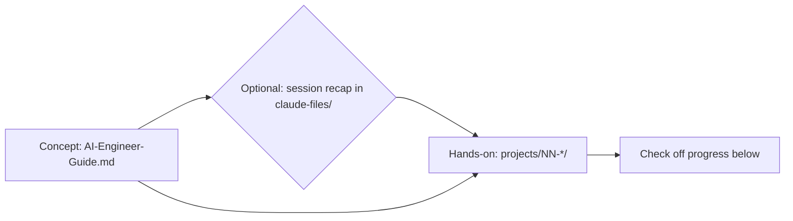

# Start Here

This is the entry point for the repository. Read this page first, then follow the learning path below. You should not need to search the folders.

## Who This Repository Is For

People who want to learn how modern AI systems are built, from Python basics to retrieval-augmented generation (RAG), LLM prompting, and agents. It is written for beginners who are comfortable reading code, but who have not built AI applications before.

## What You Will Learn

- Python for data work (NumPy, Pandas, Matplotlib)
- Machine learning and deep learning basics (training, testing, neural networks, CNNs, sequence models)
- Large language models (LLMs), prompt engineering, and how fine-tuning differs
- Retrieval-Augmented Generation (RAG) with a vector store and evaluation
- AI agents, LangGraph, and the Model Context Protocol (MCP)
- Responsible AI and a final capstone scaffold

## Prerequisites

| You need | Why | How to get it |
|---|---|---|
| Basic Python (variables, lists, functions) | All projects are in Python | Any short online course is enough |
| A Google account | Projects run in Google Colab, a free notebook service | [colab.research.google.com](https://colab.research.google.com) |
| A free Gemini API key | The LLM projects call Google Gemini | Create one in [Google AI Studio](https://aistudio.google.com/app/apikey) |

Projects 01, 02, and 03 do not need a key. Projects 04 to 09 do, except where a project offers an offline demo mode.

## Learning Path

Work through the steps in order. For each topic, read the concept, optionally read the session recap, then do the project.

1. **Python Foundations.** Read [Guide section 1](AI-Engineer-Guide.md#1-python-foundations-prerequisite-refresher). Optional recap: [10-14](claude-files/recap-2026-10-14.md). Do project [01: Python Foundations](projects/01-python-foundations/README.md).
2. **Intro to ML and DL (1A).** Read [Guide section 2](AI-Engineer-Guide.md#2-intro-to-machine-learning-ml-and-deep-learning-dl). Optional recaps: [10-26](claude-files/recap-2026-10-26.md), [10-28](claude-files/recap-2026-10-28.md). Do project [02: ML and DL Intro](projects/02-ml-and-dl-intro/README.md).
3. **Deep Learning Architectures (1B).** Read [Guide section 3](AI-Engineer-Guide.md#3-deep-learning-architectures-and-transformer-basics). Optional recaps: [10-28](claude-files/recap-2026-10-28.md), [11-02](claude-files/recap-2026-11-02.md). Do project [03: CNN and Sequence Models](projects/03-cnn-and-sequence-models/README.md).
4. **ML vs DL and the build-up to LLMs (2A).** Read [Guide section 4](AI-Engineer-Guide.md#4-ml-vs-dl-and-the-build-up-to-llms-phase-2a). Optional recap: [11-02](claude-files/recap-2026-11-02.md). This block is concept-only, so there is no project.
5. **LLMs, Prompt Engineering, and Fine-Tuning (2B).** Read [Guide section 5](AI-Engineer-Guide.md#5-llms-prompt-engineering-and-fine-tuning-phase-2b). Optional recaps: [11-02](claude-files/recap-2026-11-02.md), [11-04](claude-files/recap-2026-11-04.md). Do project [04: Prompting and PEFT](projects/04-prompting-and-peft/README.md).
6. **RAG Fundamentals (3A).** Read [Guide section 6](AI-Engineer-Guide.md#6-rag-architecture-fundamentals-phase-3a). Optional recaps: [11-04](claude-files/recap-2026-11-04.md), [11-11](claude-files/recap-2026-11-11.md). Do project [05: RAG Fundamentals](projects/05-rag-fundamentals/README.md).
7. **RAG Advanced (3B).** Read [Guide section 7](AI-Engineer-Guide.md#7-rag-architecture-advanced-phase-3b). Optional recap: [11-11](claude-files/recap-2026-11-11.md). Do project [06: RAG Advanced](projects/06-rag-advanced/README.md).
8. **LLMs vs RAG and grounding (4A).** Read [Guide section 8](AI-Engineer-Guide.md#8-llms-vs-rag-grounding-and-the-build-up-to-agentic-ai-phase-4a). Optional recaps: [11-04](claude-files/recap-2026-11-04.md), [11-11](claude-files/recap-2026-11-11.md). This block is concept-only, so there is no project.
9. **Agentic AI Introduction (4B).** Read [Guide section 9](AI-Engineer-Guide.md#9-agentic-ai-introduction-phase-4b). Optional recap: [11-11](claude-files/recap-2026-11-11.md). Do project [07: Agentic AI Intro](projects/07-agentic-ai-intro/README.md).
10. **Agentic AI and Future Directions (5A).** Read [Guide section 10](AI-Engineer-Guide.md#10-agentic-ai-and-future-directions-phase-5a). Do project [08: LangGraph Agents and MCP](projects/08-langgraph-agents-mcp/README.md).
11. **AI Assurance and Governance (5B).** Read [Guide section 11](AI-Engineer-Guide.md#11-ai-assurance-and-governance-phase-5b). This block is concept-only, so there is no project.
12. **Safety, Fairness, and Use Cases (6A).** Read [Guide section 12](AI-Engineer-Guide.md#12-safety-fairness-and-use-cases-phase-6a). This block is a discussion, so there is no project.
13. **Final Showcase (6B).** Read [Guide section 13](AI-Engineer-Guide.md#13-final-showcase-project-presentations-and-qa-phase-6b). Do project [09: Final AI Application](projects/09-final-ai-application/README.md). This is a scoped template that combines projects 05 to 08.

## How the Three Layers Fit Together

- **Guide:** the concept, with definitions and examples.
- **Recap:** what was discussed in one session. Use it to revisit the live discussion.
- **Project:** the hands-on build, usually in Google Colab.

## How to Use This Repository

### Open a project in Google Colab

1. Open the project's README. Click the **Open in Colab** badge at the top.
2. Colab opens the project's `notebook.ipynb`. Run the cells in order, top to bottom.
3. The first code cell installs the pinned packages from `requirements.txt`. Colab's environment is separate from your computer, so version clashes between projects do not matter here.

### Set your Gemini API key in Colab (do not paste it into code)

1. In Colab, click the key icon in the left sidebar (**Secrets**).
2. Click **Add new secret**. Name it exactly `GEMINI_API_KEY`, and paste your key as the value.
3. Turn on **Notebook access** for that secret.
4. The notebook reads it with `google.colab.userdata.get("GEMINI_API_KEY")`.

Never commit a key to GitHub or paste it into a shared chat. If you run a project on your own computer instead, copy `.env.example` to `.env` in that project folder and put your key there. `.env` is ignored by Git.

### What "offline mode" means

Some projects (for example 04, 07, and 08) can run without a key. They print a canned demo reply and label it **offline demo**. The offline output shows the program's structure. It is not a real model answer.

## Progress Checklist

Tick each box as you finish a project. Concept-only blocks are included so you can track your reading.

- [ ] 01 Python Foundations (project 01)
- [ ] 1A Intro to ML and DL (project 02)
- [ ] 1B DL Architectures and Transformers (project 03)
- [ ] 2A ML vs DL and build-up to LLMs (reading only)
- [ ] 2B LLMs, Prompting, and PEFT (project 04)
- [ ] 3A RAG Fundamentals (project 05)
- [ ] 3B RAG Advanced (project 06)
- [ ] 4A LLMs vs RAG and grounding (reading only)
- [ ] 4B Agentic AI Introduction (project 07)
- [ ] 5A Agentic AI and LangGraph (project 08)
- [ ] 5B AI Assurance and Governance (reading only)
- [ ] 6A Safety, Fairness, and Use Cases (reading only)
- [ ] 6B Final Showcase (project 09)

## Further Reference

- [README.md](README.md): the repository index
- [AI-Engineer-Guide.md](AI-Engineer-Guide.md): the full study guide
- [claude-files/](claude-files/): per-session recaps
- [projects/README.md](projects/README.md): the projects index and suggested path
