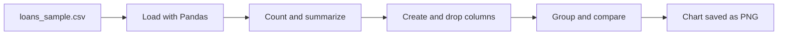

# Project 01: Analyze a Loan Dataset with Python

[](https://colab.research.google.com/github/TharunPatel20/GenAI-Engineer/blob/main/projects/01-python-foundations/notebook.ipynb)

Build a short script that loads a loan dataset, counts and summarizes it, creates a new column, and saves a chart.

- **Difficulty:** Beginner
- **Estimated time:** 60 to 90 minutes

## Learning Objectives

By the end you will be able to:
- Set up a Python virtual environment and install pinned packages
- Load a CSV file with Pandas and inspect it (`head`, `value_counts`, `describe`)
- Create and drop columns
- Group and summarize data (`groupby`)
- Draw and save a chart with Matplotlib

## Prerequisites

- Python 3.10 or newer (`python --version`)
- A code editor (for example VS Code, free)
- No prior project required. This is the first project.
- No API keys needed.

## Run in Google Colab

1. Click the **Open in Colab** badge at the top of this README.
2. Run the cells in order, from top to bottom.
3. If the repo placeholder in Step 0 is not set, upload the project files with the Files panel (left sidebar) into a folder named `01-python-foundations`.
4. This project needs no API key.
5. The local setup below is the alternative if you prefer to run on your own computer.

## Setup

1. Open a terminal in this folder.
2. Create and activate a virtual environment.

   Windows (PowerShell):
   ```powershell
   python -m venv .venv
   .venv\Scripts\Activate.ps1
   ```

   macOS or Linux:
   ```bash
   python3 -m venv .venv
   source .venv/bin/activate
   ```

3. Install the pinned packages:
   ```bash
   pip install -r requirements.txt
   ```
4. `.env.example` is not needed for this project. It is included for consistency with later projects.

## Build Steps

### Step 1: Load the data
**What:** Read the CSV into a table (a DataFrame).
**Why:** Almost all data work starts by loading data into a structure you can query.
**Code:**
```python
import pandas as pd
data = pd.read_csv("loans_sample.csv")
print(data.head())
```

### Step 2: Count categories
**What:** Count approved (Y) and rejected (N) applications.
**Why:** `value_counts()` answers "how many of each?" in one line.
**Code:**
```python
print(data["Loan_Status"].value_counts())
```

### Step 3: Summarize numbers
**What:** Get mean, standard deviation, and quartiles for numeric columns.
**Why:** Summary statistics reveal the typical values and spread of your data.
**Code:**
```python
print(data.describe())
```

### Step 4: Create and drop columns
**What:** Add `Total_Income` (applicant plus co-applicant income) and remove the two original columns.
**Why:** Creating and dropping columns is how you shape data for analysis.
**Code:**
```python
data["Total_Income"] = data["Applicant_Income"] + data["Coapplicant_Income"]
data = data.drop(columns=["Applicant_Income", "Coapplicant_Income"])
```

### Step 5: Encode a text column
**What:** Map `Married` from "No" and "Yes" to 0 and 1.
**Why:** Most machine learning tools need numbers, not text. You will use this idea in Project 02.
**Code:**
```python
data["Married_Code"] = data["Married"].map({"No": 0, "Yes": 1})
```

### Step 6: Group and compare
**What:** Compare average total income for approved and rejected applications.
**Why:** `groupby` is the core tool for comparing groups.
**Code:**
```python
print(data.groupby("Loan_Status")["Total_Income"].mean().round(0))
```

### Step 7: Plot and save a chart
**What:** Draw a bar chart and save it as `loan_status_chart.png`.
**Why:** Charts make patterns easy to see and share.
**Code:**
```python
import matplotlib.pyplot as plt
counts = data["Loan_Status"].value_counts().reindex(["Y", "N"])
plt.bar(["Approved (Y)", "Rejected (N)"], counts.values)
plt.ylabel("Number of applications")
plt.savefig("loan_status_chart.png")
```

The full script, with all steps together, is in `analyze_loans.py`. Run it with:
```bash
python analyze_loans.py
```

## Expected Output and Checkpoints

| Checkpoint | What you should see |
|---|---|
| After Step 1 | First 5 rows with the columns `Loan_ID` through `Loan_Status` |
| After Step 2 | Counts for `Y` and `N` that add up to 20 (the sample has 20 rows) |
| After Step 4 | A `Total_Income` column, and no `Applicant_Income` or `Coapplicant_Income` |
| After Step 6 | Two average incomes, one for `Y` and one for `N` |
| After Step 7 | The message `Saved chart to loan_status_chart.png`, and the PNG file in this folder |

## Diagram



## Troubleshooting

| Problem | Likely cause | Fix |
|---|---|---|
| `FileNotFoundError: loans_sample.csv` | Terminal is not in this folder | Run `cd` to this folder, then retry |
| `ModuleNotFoundError: pandas` | Virtual environment not active, or packages not installed | Activate `.venv`, then run `pip install -r requirements.txt` |
| `PowerShell cannot run scripts` (Windows) | Execution policy blocks activation | Run `Set-ExecutionPolicy -Scope CurrentUser RemoteSigned`, then activate again |
| Chart window does not appear | Script saves a file and does not open a window | Open `loan_status_chart.png` in this folder |
| `KeyError: 'Total_Income'` | Step 4 was skipped | Run Step 4 (or re-run the script from the top) |
| `KeyError: 'Applicant_Income'` | Step 4 was run twice, so the original columns were already dropped | Re-run the script from the top |

## Stretch Goals

1. Add a column `Income_Band` that labels each row "low", "medium", or "high" based on `Total_Income` (try `pd.cut`).
2. Compare approval rate by `Property_Area` (`groupby` plus `value_counts(normalize=True)`).
3. Print the rows with missing values, if any, using `isna().sum()`.
4. Save a second chart comparing average `Loan_Amount` by `Loan_Status`.

## What You Learned

- Loading and inspecting a CSV with Pandas
- Counting, summarizing, and grouping data
- Creating, dropping, and encoding columns
- Drawing and saving a chart with Matplotlib

## References

- Course recap: [claude-files/recap-2026-10-14.md](../../claude-files/recap-2026-10-14.md) (the same concepts, `value_counts`, `describe`, label encoding, and the bar chart, were covered in this session)
- Study guide: [AI-Engineer-Guide.md](../../AI-Engineer-Guide.md), section 1 (Python Foundations)
- Dataset: a small synthetic sample modeled on the course loan dataset. It is not the original data.
