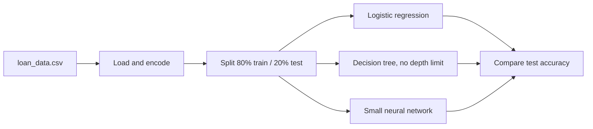

# Project 02: Train a Loan Approval Classifier (ML and DL Intro)

[](https://colab.research.google.com/github/TharunPatel20/GenAI-Engineer/blob/main/projects/02-ml-and-dl-intro/notebook.ipynb)

Train three models on one loan dataset: a logistic regression, a decision tree that overfits, and a small neural network. Then compare how well each one predicts loan approval on data it has not seen.

- **Difficulty:** Beginner
- **Estimated time:** 60 to 90 minutes

## Learning Objectives

By the end you will be able to:
- Explain supervised learning, labeled data, and the difference between inputs (X) and target (y)
- Split data into a training set (80%) and a testing set (20%)
- Train a classifier with scikit-learn (`fit`, `score`)
- Spot overfitting by comparing train accuracy with test accuracy
- Describe what a neural network does: layers, forward propagation, backward propagation, and activation functions

## Prerequisites

- Python 3.10 or newer (`python --version`)
- A code editor (for example VS Code, free)
- Project 01 completed, or equal Pandas basics: [../01-python-foundations/README.md](../01-python-foundations/README.md)
- No API keys needed.

## Run in Google Colab

1. Click the **Open in Colab** badge at the top of this README.
2. Colab opens `notebook.ipynb`. Run the cells in order, top to bottom.
3. Step 0 looks for `loan_data.csv` in the cloned repo, or next to the notebook. If it is not there, a file picker opens. Upload `loan_data.csv` from this project folder.
4. No API key is needed. The Setup cell installs the pinned `numpy`, `pandas`, and `scikit-learn` versions from `requirements.txt`. Colab may ask you to restart the runtime. If it does, run the cells again from the top.

## Setup

1. Open a terminal in this folder.
2. Create and activate a virtual environment.

   Windows (PowerShell):
   ```powershell
   python -m venv .venv
   .venv\Scripts\Activate.ps1
   ```

   macOS or Linux:
   ```bash
   python3 -m venv .venv
   source .venv/bin/activate
   ```

3. Install the pinned packages:
   ```bash
   pip install -r requirements.txt
   ```
   The file pins `numpy`, `pandas`, and `scikit-learn`. It also pins `scipy`, because scikit-learn depends on it and the newest scipy does not work with this scikit-learn version.
4. `.env.example` is not needed for this project. It is included for consistency with later projects.

## Build Steps

### Step 1: Load the data
**What:** Read `loan_data.csv` into a table (a DataFrame). Each row is one applicant.
**Why:** `Loan_Status` is the answer we want to predict. Data that includes the answer is called **labeled data**, and it is what supervised learning needs.
**Code:**
```python
import pandas as pd
data = pd.read_csv("loan_data.csv")
print(data.head())
```

### Step 2: Prepare the columns
**What:** Divide the income and loan columns by 1000, change `Education` and `Loan_Status` from text to 0/1, and one-hot encode `Property_Area` (one 0/1 column per area).
**Why:** Models only work with numbers. Smaller numbers help training run smoothly. This step is the "preprocess data" step of the five-step workflow.
**Code:**
```python
for col in ["Applicant_Income", "Coapplicant_Income", "Loan_Amount"]:
    data[col] = data[col] / 1000
data["Education"] = data["Education"].map({"Not Graduate": 0, "Graduate": 1})
data["Loan_Status"] = data["Loan_Status"].map({"N": 0, "Y": 1})
data = pd.get_dummies(data, columns=["Property_Area"], dtype=int)
```

### Step 3: Split into inputs (X), target (y), and train/test sets
**What:** Put every column except `Loan_Status` into `X` (the inputs). Put `Loan_Status` into `y` (the target). Then split the rows: 80% for training and 20% for testing.
**Why:** The model learns from the training rows. The test rows are held back, so we can check the model on applicants it has never seen. Without this split, a score only shows how well the model memorized the data.
**Code:**
```python
from sklearn.model_selection import train_test_split

X = data.drop(columns=["Loan_Status"])
y = data["Loan_Status"]
X_train, X_test, y_train, y_test = train_test_split(
    X, y, test_size=0.2, random_state=42
)
```

### Step 4: Train logistic regression
**What:** Fit a logistic regression model and measure accuracy on both sets. Accuracy is the share of correct predictions.
**Why:** Logistic regression is a simple, standard classifier. Its output is a yes or no answer (1 or 0), which fits a loan decision.
**Code:**
```python
from sklearn.linear_model import LogisticRegression

logreg = LogisticRegression(max_iter=1000)
logreg.fit(X_train, y_train)
print(logreg.score(X_train, y_train))
print(logreg.score(X_test, y_test))
```

### Step 5: Show overfitting with a decision tree
**What:** Train a decision tree with no depth limit, then compare its train and test accuracy.
**Why:** With no limit, the tree keeps splitting until it memorizes the training rows. It scores almost perfectly on data it has already seen, but worse on new data. The gap between the two scores is **overfitting**.
**Code:**
```python
from sklearn.tree import DecisionTreeClassifier

tree = DecisionTreeClassifier(random_state=42)  # no max_depth = no limit
tree.fit(X_train, y_train)
print(tree.score(X_train, y_train))  # close to 1.0
print(tree.score(X_test, y_test))    # lower
```

### Step 6: Train a small neural network
**What:** Train a multi-layer perceptron (MLP) with one hidden layer of 8 neurons. Its hidden layer uses the ReLU activation function.
**Why:** This is the simplest neural network. During training, each **epoch** runs forward propagation (inputs flow forward to a prediction) and backward propagation (the error flows back and the weights are adjusted). ReLU is applied to each hidden neuron's output so the network can learn non-linear patterns.
**Code:**
```python
from sklearn.neural_network import MLPClassifier

mlp = MLPClassifier(hidden_layer_sizes=(8,), activation="relu",
                    max_iter=2000, random_state=42)
mlp.fit(X_train, y_train)
print(mlp.score(X_test, y_test))
```

### Step 7: Compare the three models
**What:** Print the test accuracy of each model side by side.
**Why:** Test accuracy is the fair comparison, because every model is scored on the same unseen rows. A simple model can beat a complex one on a small dataset.

The full script, with all steps together, is in `train_loan_model.py`. Run it with:
```bash
python train_loan_model.py
```

The script only prints results. It does not create any files.

## Expected Output and Checkpoints

Example output (illustrative, not captured from a real run). The first table is abbreviated by Pandas, so you may see `...` between columns:

```text
First 5 rows:
   Applicant_Income  Coapplicant_Income  ...  Education  Loan_Status
0              6065                 216  ...   Graduate            Y
1              3233                   0  ...   Graduate            N
2              6848                3178  ...   Graduate            Y
3              3533                   0  ...   Graduate            Y
4              3558                 427  ...   Graduate            Y

[5 rows x 7 columns]

Rows: 300

Training rows: 240   Testing rows: 60

--- Model 1: Logistic regression ---
Train accuracy: 0.762
Test accuracy:  0.783

--- Model 2: Decision tree with no depth limit (overfitting demo) ---
Train accuracy: 1.000
Test accuracy:  0.750
Gap (train minus test): 0.250

--- Model 3: Small neural network (MLP, one hidden layer of 8 neurons) ---
Train accuracy: 0.783
Test accuracy:  0.767

--- Summary (test accuracy) ---
Logistic regression: 0.783
Decision tree:       0.750
Neural network:      0.767
```

| Checkpoint | What you should see |
|---|---|
| After Step 1 | First 5 rows with the columns `Applicant_Income` through `Loan_Status` |
| After Step 3 | `Training rows: 240` and `Testing rows: 60` (the 300 rows split 80/20) |
| After Step 4 | Two accuracies, both between 0.70 and 0.85 |
| After Step 5 | Train accuracy of 1.000 and a lower test accuracy. The gap is the overfitting |
| After Step 6 | One test accuracy for the neural network, close to the other two models |
| After Step 7 | A summary of three test accuracies |

Your numbers should match the ones above, because the script uses a fixed random seed (`42`). If you change the seed or the split, your numbers will change. That is normal.

## Diagram



## Troubleshooting

| Problem | Likely cause | Fix |
|---|---|---|
| `FileNotFoundError: loan_data.csv` | The CSV is missing from this folder | Check that `loan_data.csv` is in the same folder as the script. The script finds the file next to itself, so you can run it from any folder |
| `ModuleNotFoundError: sklearn` or `pandas` | Virtual environment not active, or packages not installed | Activate `.venv`, then run `pip install -r requirements.txt` |
| `PowerShell cannot run scripts` (Windows) | Execution policy blocks activation | Run `Set-ExecutionPolicy -Scope CurrentUser RemoteSigned`, then activate again |
| `ConvergenceWarning: lbfgs failed to converge` | The model needed more iterations | The script already sets `max_iter=1000`. If you removed it, add it back |
| Accuracy numbers differ from the expected output | You changed the seed, the split, or the data, or you installed unpinned packages | Restore `random_state=42` and `test_size=0.2`, then run `pip install -r requirements.txt` again |
| Test accuracy is much lower than train accuracy for the tree | This is the overfitting you are meant to see | Read the Gap line. This is the lesson, not an error |

## Stretch Goals

1. Change `test_size` from `0.2` to `0.25` and note how the test accuracy changes. The course recap asked students to try this.
2. Limit the tree with `DecisionTreeClassifier(max_depth=3, random_state=42)`. Does the gap between train and test accuracy shrink?
3. Change the MLP to `hidden_layer_sizes=(16,)` or `(4,)`. Does test accuracy change?
4. Use `pandas` to count the approved and rejected rows (`data["Loan_Status"].value_counts()`). Is the data balanced?

## What You Learned

- Labeled data has inputs (X) and a known target (y). Supervised learning uses it.
- A train/test split checks a model on data it has not seen.
- Logistic regression is a simple classifier and a strong baseline.
- Overfitting is a large gap between train accuracy and test accuracy.
- A neural network stacks layers of weighted connections. Forward propagation makes predictions, backward propagation adjusts the weights, and activation functions add non-linear behavior.

## References

- Course recap, supervised learning and the five-step workflow: [../../claude-files/recap-2026-10-26.md](../../claude-files/recap-2026-10-26.md)
- Course recap, neural networks, activation functions, and propagation: [../../claude-files/recap-2026-10-28.md](../../claude-files/recap-2026-10-28.md)
- Study guide: [../../AI-Engineer-Guide.md](../../AI-Engineer-Guide.md), section 2 (Intro to Machine Learning and Deep Learning)
- Dataset: `loan_data.csv` is a **synthetic** dataset of 300 rows, generated with a fixed random seed. It contains no real personal data. The approval rule behind it is made up for teaching.
