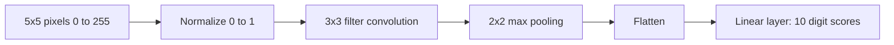
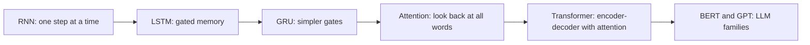

# Project 03: Convolution, a Small CNN, and Sequence Models

[](https://colab.research.google.com/github/TharunPatel20/GenAI-Engineer/blob/main/projects/03-cnn-and-sequence-models/notebook.ipynb)

Build a convolution and max pooling step by hand with numpy, then train a small CNN on handwritten digit images with PyTorch. You also read about RNN, LSTM, GRU, and the Transformer, with no code for the Transformer.

- **Difficulty:** Beginner
- **Estimated time:** 90 to 120 minutes (CPU training takes a few minutes)

## Learning Objectives

By the end you will be able to:
- Explain how a 3x3 filter slides over a 5x5 grayscale image, and check the output size with `N - F + 1`
- Apply 2x2 max pooling and say what it does to the size of a feature map
- Train a small CNN with PyTorch (convolution, ReLU, pooling, flatten, linear layer)
- Explain epochs, loss, and test accuracy in your own words
- Describe, in plain language, how RNN, LSTM, GRU, and the Transformer differ (conceptual only)

## Prerequisites

- **Project 01** (Python Foundations): you can create a virtual environment, install pinned packages, and run a script.
- **Project 02** (Logistic regression on loan data): you know the idea of a training set, a test set, and accuracy. Project 02 is not in this folder yet. If you have not done it, read the matching session recap before you start.
- Python 3.10 or newer (`python --version`). The scratch test used Python 3.13.
- A code editor (for example VS Code, free)
- About 1 GB of free disk space for the CPU build of PyTorch.
- No API keys needed.

## Run in Google Colab

Click the **Open in Colab** badge at the top of this page, then run the cells top to bottom.

- Colab already includes PyTorch (a CUDA build). The torch pin in `requirements.txt` (`torch==2.6.0+cpu`) is a CPU-only build that does not install on Colab, so the notebook installs only the numpy and scikit-learn pins and keeps Colab's own torch. The local setup below keeps the CPU pin.
- No API key is needed.
- A GPU is optional. The training code runs on the CPU as written, so a GPU only helps if you change the code to use it.

## Setup

1. Open a terminal in this folder.
2. Create and activate a virtual environment.

   Windows (PowerShell):
   ```powershell
   python -m venv .venv
   .venv\Scripts\Activate.ps1
   ```

   macOS or Linux:
   ```bash
   python3 -m venv .venv
   source .venv/bin/activate
   ```

3. Install the pinned packages. PyTorch is installed as the **CPU-only** build from the PyTorch index, which is much smaller than the default build:
   ```bash
   pip install --extra-index-url https://download.pytorch.org/whl/cpu -r requirements.txt
   ```
   This needs an internet connection. If the download is slow, add `--default-timeout=300`.

   On macOS, the `+cpu` build is not published for Mac. Remove `+cpu` from the torch line in `requirements.txt` (so it reads `torch==2.6.0`), then run the same command.

4. `.env.example` is not needed for this project. It is included for consistency with later projects.

## Build Steps

Part A (`cnn_steps.py`) uses numpy only. Part B (`train_small_cnn.py`) uses PyTorch.

### Step 1: Read the image as numbers

> The 5x5 pixel grid and the 3x3 filter used in Part A are a made-up example for this project. They are not the course's image or the course's numbers.
**What:** A grayscale image is a grid of pixels. Each pixel is a number from 0 (black) to 255 (white).
**Why:** A CNN never sees a picture. It sees a matrix of numbers.
**Code:**
```python
pixels = np.array([
    [10, 40, 200, 220, 30],
    [15, 50, 210, 230, 25],
    [12, 45, 205, 225, 35],
    [14, 42, 198, 218, 28],
    [11, 38, 202, 215, 32],
])
```

### Step 2: Normalize
**What:** Divide every pixel by 255 so all values are between 0 and 1.
**Why:** Small numbers keep the arithmetic simple and stable. This is the step the course calls normalization.
**Code:**
```python
feature_map = pixels / 255.0
```

### Step 3: Slide a filter (convolution)
**What:** A 3x3 filter (also called a kernel) moves across the 5x5 feature map. At each position, multiply the overlapping values and add them up. That one sum is one value in the output.
**Why:** The filter is a small pattern detector. This filter responds to vertical edges. A negative output means the right side of the patch is brighter than the left.
**Code:** the function `convolve2d` in `cnn_steps.py`, with the filter:
```python
kernel = np.array([
    [1, 0, -1],
    [1, 0, -1],
    [1, 0, -1],
])
```

### Step 4: Check the output size
**What:** The output size is `N - F + 1`. Here N = 5 and F = 3, so the output is 3x3.
**Why:** You can predict the shape of any convolution before running it. This is the size rule from the 2026-10-28 session.
**Code:**
```python
expected_size = feature_map.shape[0] - kernel.shape[0] + 1   # 5 - 3 + 1 = 3
```

### Step 5: Max pooling
**What:** A 2x2 window slides over the 3x3 output. Each window keeps only its largest value. The result is 2x2.
**Why:** Pooling shrinks the feature map and keeps the strongest signal. This is the pooling step from the 2026-11-02 session.
**Code:** the function `max_pool2d` in `cnn_steps.py`. Run the whole of Part A with:
```bash
python cnn_steps.py
```

### Step 6: Load the digit images (Part B)
**What:** `load_digits()` from scikit-learn gives 1,797 images of handwritten digits, each 8x8 pixels. No download is needed.
**Why:** Small images train in minutes on a CPU, so you can see the whole pipeline run.
**Code:**
```python
from sklearn.datasets import load_digits
digits = load_digits()
images = digits.images / 16.0            # values 0 to 16 become 0 to 1
```

### Step 7: Build a small CNN
**What:** Two blocks of convolution, ReLU, and max pooling, then a flatten step and one linear layer that outputs 10 scores (one per digit). ReLU keeps positive values and sets negative values to zero, so the model can learn non-linear patterns.
**Why:** This is the CNN pipeline in one model. The shapes show how each step changes the size: 8x8, then 4x4, then 2x2, then 64 values.
**Code:**
```python
model = nn.Sequential(
    nn.Conv2d(1, 8, kernel_size=3, padding=1),
    nn.ReLU(),
    nn.MaxPool2d(2),                    # 8x8 -> 4x4
    nn.Conv2d(8, 16, kernel_size=3, padding=1),
    nn.ReLU(),
    nn.MaxPool2d(2),                    # 4x4 -> 2x2
    nn.Flatten(),                       # 16 x 2 x 2 = 64 values
    nn.Linear(16 * 2 * 2, 10),
)
```

### Step 8: Train
**What:** One epoch is one pass over all training images. The script runs 25 epochs. In each batch, the model makes a prediction (forward propagation), measures the error (loss), and adjusts the weights (backward propagation).
**Why:** This is the training loop from the 2026-10-28 session, now with real code. The loss should go down over the epochs.
**Code:**
```python
outputs = model(batch_x)                 # forward propagation
loss = loss_function(outputs, batch_y)
loss.backward()                          # backward propagation
optimizer.step()                         # update the weights
```

### Step 9: Measure on the test set
**What:** Run the model on the 20 percent of images it never trained on, and count the correct answers.
**Why:** Accuracy on training data can look good even when the model has only memorized. The test set shows how it does on new images.
**Code:**
```python
test_acc = accuracy(x_test, y_test)
```

Run Part B with:
```bash
python train_small_cnn.py
```

## Expected Output and Checkpoints

| Checkpoint | What you should see |
|---|---|
| After Step 1 to 2 | A 5x5 matrix of pixel values, then the same grid with values between 0 and 1 |
| After Step 4 | `Check passed: output is 3x3, from 25 values down to 9` |
| After Step 5 | A 2x2 matrix of values (the first row is about -2.10 and 2.06 in this project's example, not the course's), and the line `Pooling output size: 3 - 2 + 1 = 2` |
| After Step 6 | `Loaded 1797 images of size 8x8` and `Training images: 1437, test images: 360` |
| After Step 8 | Twenty-five epoch lines. The loss goes down and the training accuracy goes up, to about 0.96 |
| After Step 9 | Example result from one test run of `train_small_cnn.py`: `Test accuracy: 0.939 (338/360 correct)`. The run log was not kept, so this number is not verified in this repository. The script sets `SEED = 42`. Your number may differ. That run used Python 3.13.2 and PyTorch 2.6.0 (CPU build). |

The pixel values and the filter are fixed in `cnn_steps.py`, so Part A prints the same numbers every time.

Part B uses a fixed seed, but results can still differ a little between computers. A test accuracy of 0.90 or higher counts as success for this exercise.

## Diagram



Part B's model, as ASCII:

```
8x8 image -> Conv 3x3 (8 filters) -> ReLU -> Pool 2x2 -> 4x4
          -> Conv 3x3 (16 filters) -> ReLU -> Pool 2x2 -> 2x2
          -> Flatten (64 values) -> Linear -> 10 scores
```

## Troubleshooting

| Problem | Likely cause | Fix |
|---|---|---|
| `ModuleNotFoundError: torch` or `sklearn` | Virtual environment not active, or packages not installed | Activate `.venv`, then run the `pip install` command in Setup step 3 |
| `ERROR: No matching distribution found for torch==2.6.0+cpu` | Mac user, or the PyTorch index could not be reached | On macOS, remove `+cpu` from `requirements.txt`. Otherwise check your internet connection and retry |
| Install times out | Large download over a slow connection | Add `--default-timeout=300` to the `pip install` command and retry |
| `PowerShell cannot run scripts` (Windows) | Execution policy blocks activation | Run `Set-ExecutionPolicy -Scope CurrentUser RemoteSigned`, then activate again |
| `AssertionError: Output size does not match` | The filter or the image was changed so the sizes no longer fit | Check that the image is 5x5 and the filter is 3x3 |
| Training is slow | Other programs use the CPU | Close other programs, or lower `EPOCHS` in `train_small_cnn.py` (accuracy will drop a little) |

## Stretch Goals

1. Change the filter in `cnn_steps.py` to a horizontal edge detector (rows of 1s on top and -1s on the bottom). Predict the output before you run the code.
2. Change `max_pool2d` to average pooling. Compare the output with the max version.
3. In `train_small_cnn.py`, change `out_channels` from 8 to 16 in the first convolution. Does the test accuracy change?
4. **Exercise (not required): a small GRU for text sequences.** Write a GRU in PyTorch (`nn.GRU`) that reads a short sentence one word at a time and predicts whether the sentence is positive or negative, using a tiny list of sentences you write yourself. Keep it under 50 lines and train for a few epochs. This is an exercise. There is no solution file in this project, and it is not part of the required work.

## What You Learned

- A convolution slides a filter over a grid and sums the products, and the output size is `N - F + 1`
- Max pooling keeps the largest value in each window and shrinks the feature map
- A small CNN in PyTorch: convolution, ReLU, pooling, flatten, linear layer
- Forward propagation, loss, backward propagation, and epochs in a training loop
- Conceptually, how RNN, LSTM, GRU, and the Transformer handle sequences (see below)

### Conceptual Overview: Sequence Models and the Transformer

No code is needed for this part. Read it and be able to explain it.

- **RNN:** reads a sequence one step at a time and keeps a memory of earlier steps. Its memory is short, so it struggles with long sentences.
- **LSTM:** an RNN with gates that decide what to keep and what to forget. It handles longer memory, but its design is complex.
- **GRU:** a simpler gated RNN that aims for similar results with fewer parts.
- **Attention:** lets the model look back at all earlier words and weigh the ones that matter most.
- **Transformer (2017 to 2018):** an encoder-decoder design built around attention. The course describes it as the base architecture of current large language models.
- **Self-attention:** each word scores how relevant every other word is to it.
- **Multi-head attention:** several self-attention computations run in parallel, each looking for a different kind of relationship.
- **Positional encoding:** adds word-order information, because attention on its own does not know the order of words.



## References

- Course recap, CNN pipeline (grayscale, pixels, normalization, feature map, convolution, `N - F + 1`): [claude-files/recap-2026-10-28.md](../../claude-files/recap-2026-10-28.md)
- Course recap, pooling, flattening, RNN, LSTM, GRU, and Transformer history: [claude-files/recap-2026-11-02.md](../../claude-files/recap-2026-11-02.md)
- Study guide: [AI-Engineer-Guide.md](../../AI-Engineer-Guide.md), section 3 (Deep Learning Architectures and Transformer Basics)
- Dataset: the scikit-learn digits dataset (`sklearn.datasets.load_digits`), bundled with scikit-learn. No download is needed.
- Note: the recaps were made from auto-generated transcripts. Some numbers in them were garbled, so this project uses its own worked example.
