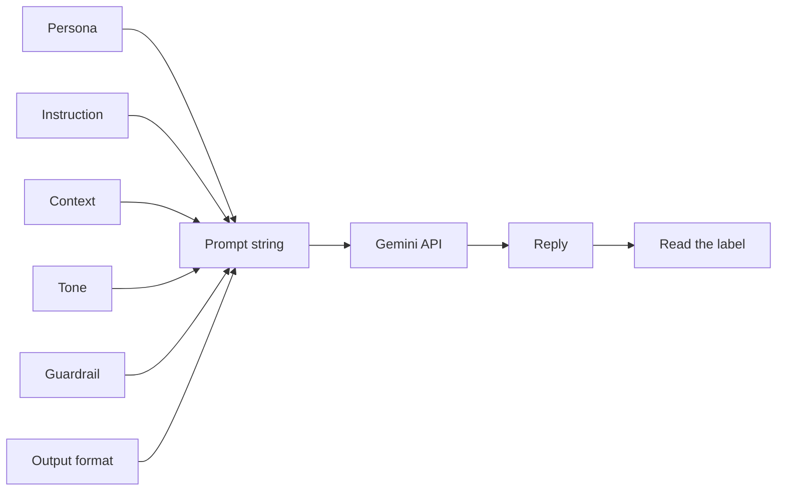

# Project 04: Prompt Engineering with Google Gemini (and a Look at PEFT)

[](https://colab.research.google.com/github/TharunPatel20/GenAI-Engineer/blob/main/projects/04-prompting-and-peft/notebook.ipynb)

Write the same task three ways (zero-shot, few-shot, and chain-of-thought), compare the results, and build a prompt from its parts to see how a guardrail changes the output.

- **Difficulty:** Beginner
- **Estimated time:** 90 to 120 minutes

> **Note on model names and free limits:** Google changes model names, free-tier quotas, and rules over time. The default model in this project is `gemini-2.5-flash`. Before you start, check the current model name and free-tier limits in [Google AI Studio](https://aistudio.google.com). If a model name is retired, change `GEMINI_MODEL` in your `.env` file.

## Learning Objectives

By the end you will be able to:
- Store an API key in a `.env` file and load it with `python-dotenv`, without putting the key in code
- Send a prompt to Gemini with the `google-genai` SDK
- Write zero-shot, few-shot, and chain-of-thought prompts for the same task
- Assemble a prompt from parts (persona, instruction, context, output format, tone, guardrail)
- Explain, at a high level, how PEFT and LoRA differ from full fine-tuning

## Prerequisites

- Python 3.10 or newer (`python --version`)
- A code editor (for example VS Code, free)
- Project 01 completed (you know how to make a virtual environment and run `pip install -r requirements.txt`)
- A free API key from Google AI Studio (see Setup, step 4)

**No key yet?** You can still run the offline demo (see Setup, step 5). It shows the structure of the comparison with canned answers, not real model output.

## Run in Google Colab

1. Click the **Open in Colab** badge at the top of this README. Colab opens `notebook.ipynb`.
2. Run the cells top to bottom. The install cell adds the pinned packages.
3. Add your Gemini key in Colab Secrets, not in the code. Click the key icon in the left sidebar, add a secret named `GEMINI_API_KEY`, and turn on notebook access.
4. The offline demo works without a key. Its output is labeled **offline demo** and shows canned answers, not real Gemini output.
5. Prefer your own computer? Use the local `.env` setup in the Setup section below.

## Setup

1. Open a terminal in this folder.
2. Create and activate a virtual environment.

   Windows (PowerShell):
   ```powershell
   python -m venv .venv
   .venv\Scripts\Activate.ps1
   ```

   macOS or Linux:
   ```bash
   python3 -m venv .venv
   source .venv/bin/activate
   ```

3. Install the pinned packages:
   ```bash
   pip install -r requirements.txt
   ```

4. Get a free API key and save it in `.env`:
   - Go to [Google AI Studio](https://aistudio.google.com), sign in, and click **Get API key**, then **Create API key**.
   - Copy the template file. Windows (PowerShell): `Copy-Item .env.example .env`. macOS or Linux: `cp .env.example .env`.
   - Open `.env` in your editor and replace `your-key-here` with your key. Keep the line as `GEMINI_API_KEY=` followed by the key, with no quotes.
   - Never share this key, paste it into code, or commit `.env` to version control.

5. Optional: run the offline demo first, which needs no key:
   ```bash
   python prompt_strategies.py --offline
   ```

## Build Steps

The two scripts are `prompt_strategies.py` (three prompting strategies) and `prompt_components.py` (prompt parts and a guardrail). Each step below explains one idea from the code.

### Step 1: Load the key safely
**What:** Read `GEMINI_API_KEY` from `.env`, not from the code.
**Why:** Keys written into code get copied, shared, and leaked. A `.env` file stays on your computer.
**Code:**
```python
from dotenv import load_dotenv
load_dotenv(Path(__file__).with_name(".env"))
api_key = os.getenv("GEMINI_API_KEY", "").strip()
```
If the key is missing, the script prints clear steps and exits. It does not crash.

### Step 2: Send one prompt
**What:** Create a client and call the model.
**Why:** Every strategy in this project uses this same call. Only the prompt text changes.
**Code:**
```python
from google import genai
client = genai.Client(api_key=api_key)
response = client.models.generate_content(model=MODEL_NAME, contents=prompt)
print(response.text)
```

### Step 3: Zero-shot prompt
**What:** One instruction, no examples.
**Why:** Simple, clear tasks often work with just an instruction. Gemini already understands simple text.
**Code:**
```python
def zero_shot_prompt(feedback):
    return f"Classify the customer feedback as positive, negative, or neutral.\nAnswer with one word only.\n\nFeedback: {feedback}\nLabel:"
```

### Step 4: Few-shot prompt
**What:** The same instruction, plus two labeled examples before the real feedback.
**Why:** Words such as "neutral" are subjective. Examples show the model what each label means in your case.
**Code:** the examples are a list of `(text, label)` pairs. The function adds each pair in turn, then the new feedback with an empty `Label:` at the end:
```python
FEW_SHOT_EXAMPLES = [
    ("The app crashes every time I open the cart.", "negative"),
    ("Support solved my issue in five minutes. Thank you!", "positive"),
]
```

### Step 5: Chain-of-thought prompt
**What:** Ask the model to list good points, then bad points, then decide, and to end with a `Final label:` line.
**Why:** Multi-step decisions go more reliably when the model reasons step by step. The cost is a longer answer, which uses more tokens.
**Code:**
```python
"Think step by step: list the good points, then the bad points, then decide which side is stronger.\n"
"End with a final line in this form: Final label: <positive|negative|neutral>"
```

### Step 6: Read the label
**What:** Find the label word in the reply. If there are several, use the last one.
**Why:** The model may explain itself before the answer. The last label is usually the final answer.
**Code:**
```python
matches = re.findall(r"\b(positive|negative|neutral)\b", text, flags=re.IGNORECASE)
label = matches[-1].lower() if matches else "unclear"
```

### Step 7: Compare side by side
**What:** Run all three prompts on each of three sample feedback lines and print a table with the expected label.
**Why:** Putting the answers next to the expected label is how you judge a prompt. Do not trust one answer.
**Code:** run `python prompt_strategies.py`. The full script is in `prompt_strategies.py`.

### Step 8: Build a prompt from parts
**What:** `build_prompt()` joins persona, instruction, context, tone, guardrail, and output format into one string. The guardrail is optional.
**Why:** Each part can be changed on its own, so prompts are easier to reuse and test.
**Code:**
```python
def build_prompt(persona, instruction, context, tone, output_format, guardrail=None):
    lines = [f"You are a {persona}.", f"Task: {instruction}", f"Context: {context}", f"Tone: {tone}"]
    if guardrail:
        lines.append(f"Rules you must follow: {guardrail}")
    lines.append(f"Output format: {output_format}")
    return "\n".join(lines)
```

### Step 9: See what a guardrail changes
**What:** Send the customer-email prompt with and without the guardrail "Do not promise a refund."
**Why:** Guardrails tell the model what it must not do. They are often skipped, and without one the model may promise things you cannot deliver.
**Code:** run `python prompt_components.py`. The full script is in `prompt_components.py`.

The scripts are run with:
```bash
python prompt_strategies.py
python prompt_components.py
```

## Expected Output and Checkpoints

| Checkpoint | What you should see |
|---|---|
| After Setup step 4 | `.env` exists in this folder and contains your key. `.env` is listed in your `.gitignore` if you use Git |
| After `python prompt_strategies.py --offline` | A table with three rows, labeled `OFFLINE DEMO` at the top and the bottom. No error |
| After `python prompt_strategies.py` (with a key) | A table of labels for each feedback line. Compare them with the Expected column |
| After `python prompt_components.py` (no key) | Two prompts (one with a `Rules you must follow` line, one without), then two canned replies marked as offline demo |
| After `python prompt_components.py` (with a key) | Two real replies from Gemini. The guarded one should avoid promising a refund |

Without a key, `python prompt_strategies.py` prints the setup steps and exits. That is the expected behavior.

## Diagram



## Troubleshooting

| Problem | Likely cause | Fix |
|---|---|---|
| `No Gemini API key found.` | `.env` is missing, or the key line still says `your-key-here` | Create `.env` from `.env.example` and paste your key |
| `ModuleNotFoundError: google` or `dotenv` | Virtual environment not active, or packages not installed | Activate `.venv`, then run `pip install -r requirements.txt` |
| `PowerShell cannot run scripts` (Windows) | Execution policy blocks activation | Run `Set-ExecutionPolicy -Scope CurrentUser RemoteSigned`, then activate again |
| `404 NOT_FOUND` or "model not found" | The model name in `GEMINI_MODEL` (or the default) is retired | Check the current name in Google AI Studio and set `GEMINI_MODEL` in `.env` |
| `429` or "quota exceeded" | Free-tier limit reached for the day or minute | Wait and run again, or run `--offline` to practice the structure |
| Labels say `unclear` | The reply had no positive, negative, or neutral word | Print the reply and check the prompt, or add a stricter output format |
| Output differs from the course or from a classmate | Models are not fully deterministic, and versions change | This is expected. Compare the pattern, not the exact words |

## Stretch Goals

1. Add a fourth feedback line that is hard to label (for example, mixed feedback). Does zero-shot, few-shot, or chain-of-thought get it right?
2. Add a third few-shot example. Does the answer change?
3. Change `OUTPUT_FORMAT` in `prompt_components.py` to "A single paragraph, no greeting". Does the reply follow it?
4. Write a guardrail of your own (for example "Do not mention other customers") and test whether it changes the reply.

### Stretch (reading only): PEFT and LoRA

You do not build a fine-tuning run in this project. Read this section and the reference link.

- **Fine-tuning** updates the weights of a whole model. It needs a lot of memory and compute. The course recap lists it as the most expensive of the three hallucination mitigations.
- **PEFT (Parameter-Efficient Fine-Tuning)** updates only a small set of extra or selected parameters and keeps the original weights frozen. It needs far less compute.
- **LoRA (Low-Rank Adaptation)** freezes the original weight matrix `W` and learns a small update `ΔW = B × A`, where `A` and `B` are much smaller than `W`. Only `A` and `B` are trained.
- **QLoRA (Quantized LoRA)** runs LoRA on a model stored with lower-precision numbers, which saves memory.

```
Full fine-tuning:  train every weight in W           (large cost)
LoRA:              keep W frozen, train small A and B  (small cost)
                   output = W x + B (A x)
```

Reference to read later: [Hugging Face PEFT documentation](https://huggingface.co/docs/peft/index).

## What You Learned

- Keeping an API key in `.env` and loading it with `python-dotenv`
- Sending a prompt to Gemini with the `google-genai` SDK
- Zero-shot, few-shot, and chain-of-thought prompting, and when to use each
- Building a prompt from parts, and testing how a guardrail changes the output
- The idea behind PEFT and LoRA, at a high level

## References

- Course recap, prompt components and strategies: [claude-files/recap-2026-11-02.md](../../claude-files/recap-2026-11-02.md)
- Course recap, hallucination, and prompt engineering vs. RAG vs. fine-tuning: [claude-files/recap-2026-11-04.md](../../claude-files/recap-2026-11-04.md)
- Study guide: [AI-Engineer-Guide.md](../../AI-Engineer-Guide.md), [section 5](../../AI-Engineer-Guide.md#5-llms-prompt-engineering-and-fine-tuning-phase-2b) (LLMs, Prompt Engineering, and Fine-Tuning)
- Google AI Studio (API keys, model names, free-tier limits): https://aistudio.google.com
- Hugging Face PEFT documentation (stretch reading): https://huggingface.co/docs/peft/index
