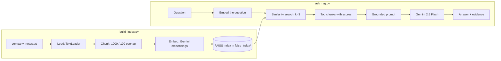

# Project 05: Build a Small RAG Pipeline with Gemini

[](https://colab.research.google.com/github/TharunPatel20/GenAI-Engineer/blob/main/projects/05-rag-fundamentals/notebook.ipynb)

Build a short retrieval-augmented generation (RAG) pipeline. It loads a text file, splits it into chunks, stores the chunks as vectors in FAISS, retrieves the most relevant chunks for a question, and asks Gemini to answer from those chunks only.

- **Difficulty:** Beginner
- **Estimated time:** 90 to 120 minutes (plus about 10 minutes for the stretch exercise)

## Learning Objectives

By the end you will be able to:
- Load a text document with a LangChain document loader
- Split a document into overlapping chunks and explain why chunking matters
- Create embeddings with Gemini and store them in a FAISS vector store
- Retrieve the closest chunks for a question and read the scores
- Write a grounded prompt that tells the model to answer only from the context
- Explain lost-in-the-middle and the chunk-size trade-off

## Prerequisites

- Python 3.10 or newer (`python --version`)
- A code editor (for example VS Code, free)
- Project 01 (Python basics, virtual environments, `pip install -r requirements.txt`): [../01-python-foundations/README.md](../01-python-foundations/README.md)
- Project 04 (calling Gemini and loading a key from `.env`): [../04-prompting-and-peft/README.md](../04-prompting-and-peft/README.md)
- A Gemini API key from Google AI Studio (free tier). Go to aistudio.google.com and choose "Get API key".

## Run in Google Colab

Click the **Open in Colab** badge at the top of this README. Colab opens `notebook.ipynb` in this project folder. Run the cells top to bottom. Step 0 gets the project files, and Step 1 installs the pinned packages from `requirements.txt`.

Add your Gemini key in Colab Secrets, not in a cell: click the key icon in the left sidebar, add a secret named `GEMINI_API_KEY`, and turn on notebook access. Step 2 reads it from there.

The `faiss_index/` folder is created in Colab's session storage when you run Step 3. It is not committed to the repository, and it disappears when the Colab session ends. Run Steps 1 to 3 again in a new session to rebuild it.

To run on your own computer instead, use the local `.env` setup below.

## Setup

1. Open a terminal in this folder.
2. Create and activate a virtual environment.

   Windows (PowerShell):
   ```powershell
   python -m venv .venv
   .venv\Scripts\Activate.ps1
   ```

   macOS or Linux:
   ```bash
   python3 -m venv .venv
   source .venv/bin/activate
   ```

3. Install the pinned packages:
   ```bash
   pip install -r requirements.txt
   ```
4. Create your `.env` file from the template, then open it and paste your key after `GEMINI_API_KEY=`.

   Windows (PowerShell):
   ```powershell
   cp .env.example .env
   ```

   macOS or Linux:
   ```bash
   cp .env.example .env
   ```

**Keep your key private.** Never commit `.env` to version control. The `faiss_index/` folder is also generated from your files and should not be committed. You can rebuild it at any time with `build_index.py`.

## Build Steps

The two scripts follow the five steps below. `build_index.py` covers steps 1 to 3. `ask_rag.py` covers steps 4 and 5.

### Step 1: Load the document
**What:** Read `sample_docs/company_notes.txt` into a LangChain `Document`.
**Why:** The pipeline needs text before it can do anything else. A document loader hides the file reading. PDF, web, and spreadsheet loaders work the same way in later projects.
**Code:**
```python
from langchain_community.document_loaders import TextLoader

loader = TextLoader("sample_docs/company_notes.txt", encoding="utf-8")
documents = loader.load()
print(f"Loaded {len(documents)} document")
```

### Step 2: Split the text into chunks
**What:** Split the document into pieces of up to 1000 characters, with 100 characters of overlap between neighbors.
**Why:** An embedding represents one piece of text as one vector. A whole document makes a vague vector, and a model's context window is limited. Smaller chunks give more precise matches. The overlap keeps a sentence that crosses a boundary available in both chunks.
**Code:**
```python
from langchain_text_splitters import RecursiveCharacterTextSplitter

splitter = RecursiveCharacterTextSplitter(chunk_size=1000, chunk_overlap=100)
chunks = splitter.split_documents(documents)
print(f"Split into {len(chunks)} chunks")
```

### Step 3: Embed the chunks and store them in FAISS
**What:** Send each chunk to Gemini's embedding model (`models/gemini-embedding-001`). Store the vectors in a FAISS index and save it to a folder named `faiss_index/`.
**Why:** An embedding turns meaning into numbers, so similar text gets similar vectors. FAISS is a fast local store for vectors. Saving the index means you do not pay to re-embed the document every time you ask a question.
**Code:**
```python
from langchain_community.vectorstores import FAISS
from langchain_google_genai import GoogleGenerativeAIEmbeddings

embeddings = GoogleGenerativeAIEmbeddings(model="models/gemini-embedding-001", google_api_key=api_key)
vector_store = FAISS.from_documents(chunks, embeddings)
vector_store.save_local("faiss_index")
```

Run steps 1 to 3 with:
```bash
python build_index.py
```

### Step 4: Retrieve the closest chunks
**What:** Load the saved index, embed the question with the same embedding model, and ask FAISS for the 3 closest chunks with `similarity_search_with_score(question, k=3)`.
**Why:** Retrieval decides what the model is allowed to read. If the right chunk is not retrieved, the answer will be wrong no matter how good the model is. Always embed the question with the same model you used for the chunks. Comparing vectors from different models is like comparing kilograms with pounds.
**Code:**
```python
vector_store = FAISS.load_local("faiss_index", embeddings, allow_dangerous_deserialization=True)
results = vector_store.similarity_search_with_score(question, k=3)
for chunk, score in results:
    print(score, chunk.page_content[:150])
```

**Score direction (read this).** The score is a number from the library, and its meaning depends on the library and the distance setting. FAISS with its default L2 (Euclidean) distance returns a distance, where a lower number means a closer match. Other setups, such as cosine similarity, can work the other way round. **Do not assume that a higher score is better.** Check the LangChain and FAISS docs for your installed version before you read meaning into a score. The scripts print a neutral label for this reason.

### Step 5: Generate a grounded answer
**What:** Put the retrieved chunks into a prompt with rules: answer only from the context, say "I don't know" if the answer is missing, and give supporting evidence. Send the prompt to `gemini-2.5-flash`.
**Why:** This is the "augmented" part of RAG. Grounding limits hallucination, and the evidence lets a person check the answer against the source.
**Code:**
```python
from langchain_google_genai import ChatGoogleGenerativeAI

llm = ChatGoogleGenerativeAI(model="gemini-2.5-flash", google_api_key=api_key)
reply = llm.invoke(prompt)  # prompt holds the rules, the chunks, and the question
print(reply.content)
```

Run steps 4 and 5 with the default question:
```bash
python ask_rag.py
```

Or ask your own question. Put it in quotes:
```bash
python ask_rag.py "Which product sold the most units in 2025?"
```

The full scripts are in `build_index.py` (steps 1 to 3) and `ask_rag.py` (steps 4 and 5).

## Lost in the Middle and Chunk-Size Trade-offs

Two limits to keep in mind when you change the settings:

- **Lost in the middle.** Research on long prompts has found that models use facts at the start and end of a long context more reliably than facts in the middle. If you retrieve many chunks, the best one may land in the middle and be missed. The fixes are to retrieve fewer, better chunks, to rank chunks so the best ones come first, or to re-rank them before generation. Re-ranking is covered in Phase 3B.
- **Chunk size is a trade-off.**
  - Small chunks (for example 300 characters) match precisely, but each chunk may lack the context needed for an answer. You also get more chunks to search.
  - Large chunks (for example 1000 or more) keep more context, but one chunk may hold several topics, which weakens the match. Each chunk also takes more room in the prompt.
  - Overlap helps at the edges, but it stores some text twice, which makes the index a little larger.

## Expected Output and Checkpoints

**Illustrative example output, not captured from a real run.** The numbers, scores, and wording on your machine will differ. Check your own output against the checkpoints in the table, not against this example.

Example of `python build_index.py`:
```
Loaded 1 document from company_notes.txt
Split into 3 chunks (chunk_size=1000, overlap=100)
Saved index with 3 chunks to faiss_index/
```

Example of `python ask_rag.py`:
```
Question: How much will Acme Robotics invest in AI in 2026, and where will the money go?

Top 3 chunks with scores (check the score direction in the LangChain and FAISS docs):
  [1] score=0.7412  2026 AI INVESTMENT PLAN Acme Robotics plans to invest 9 million dollars in ...
  [2] score=0.8059  ...

Answer:
Acme Robotics plans to invest 9 million dollars in AI in 2026. It will spend 4 million on vision
models, 3 million on planning software, and 2 million on internal AI tools.
Evidence: [Chunk 1] "Acme Robotics plans to invest 9 million dollars in artificial intelligence during 2026."
```

| Checkpoint | What you should see |
|---|---|
| After Step 1 | `Loaded 1 document` (the text file loads as one document) |
| After Step 2 | A chunk count of 1 or more. Write it down. You will compare it in the stretch exercise |
| After Step 3 | A new `faiss_index/` folder appears in this project folder |
| After Step 4 | Three chunks printed with scores. The first chunk should mention AI investment |
| After Step 5 | An answer that matches `company_notes.txt`, with quoted evidence |
| Missing-answer test | Run `python ask_rag.py "Who is the CEO of Acme Robotics?"`. The file does not say, so the answer should be "I don't know" |

## Diagram



## Troubleshooting

| Problem | Likely cause | Fix |
|---|---|---|
| `No Gemini API key found.` | `.env` is missing, or the key was not pasted | Run `cp .env.example .env` and paste your key after `GEMINI_API_KEY=` |
| `No index found in faiss_index/` | You ran `ask_rag.py` before `build_index.py` | Run `python build_index.py` first |
| `ModuleNotFoundError: langchain_community` (or another package) | Virtual environment not active, or packages not installed | Activate `.venv`, then run `pip install -r requirements.txt` |
| `No matching distribution found for faiss-cpu` | Your Python version has no FAISS wheel | Use Python 3.11 or 3.12, then recreate `.venv` |
| `PowerShell cannot run scripts` (Windows) | Execution policy blocks activation | Run `Set-ExecutionPolicy -Scope CurrentUser RemoteSigned`, then activate again |
| `FileNotFoundError: sample_docs/company_notes.txt` | The file is missing or was moved | Check that `sample_docs/company_notes.txt` exists in this folder |
| `429` or `RESOURCE_EXHAUSTED` errors | Free-tier rate or quota limit reached | Wait a minute and retry. Run fewer questions in a row |
| `404` or `model not found` | Model name changed | Check the current names in Google AI Studio and update the constant at the top of the script |
| Answer is "I don't know" for a question the file answers | Retrieval missed the chunk | Print the retrieved chunks, then try a more specific question or a smaller chunk size |
| `allow_dangerous_deserialization` error | Older or newer LangChain version | Keep the versions in `requirements.txt` |

## Stretch Goals

1. **Chunk-size experiment (the main exercise).** In `build_index.py`, change `CHUNK_SIZE` to 300 and `CHUNK_OVERLAP` to 30. Run `python build_index.py` again, then ask the same three questions with `ask_rag.py`. Record the chunk count, the three chunk previews, and the answers. Then set the size back to 1000 and compare. Which setting gave the cleaner evidence? Which gave more context?
2. Ask a question with two parts, such as "What is the 2026 AI budget and what is the main risk?" Does one chunk answer both parts? Try `TOP_K = 5` and see whether the answer improves or the prompt gets noisy.
3. Add your own short `.txt` file to `sample_docs/`, change `DOC_PATH` to point at it, and rebuild the index. Ask three questions about it.
4. Add a score threshold. Print a warning when the best score is worse than a value you choose. Before you do this, confirm the score direction in the FAISS docs.

## What You Learned

- Loading a document with a LangChain document loader
- Splitting text into overlapping chunks, and the trade-off between precision and context
- Creating embeddings and storing them in a FAISS vector store that you can save and reload
- Retrieving the closest chunks and reading scores with care (the direction depends on the library)
- Writing a grounded prompt that asks for evidence and allows "I don't know"
- Why lost-in-the-middle makes retrieval quality matter

## References

- Course recap: [claude-files/recap-2026-11-04.md](../../claude-files/recap-2026-11-04.md) (the RAG pipeline: ingestion, chunking, embeddings, vector store, query embedding, similarity, and augmentation)
- Course recap: [claude-files/recap-2026-11-11.md](../../claude-files/recap-2026-11-11.md) (PyPDF loading, `RecursiveCharacterTextSplitter` at 1000 and 100, Gemini embeddings, FAISS, similarity search with score, the grounded RAG prompt, and `k=1`)
- Study guide: [AI-Engineer-Guide.md](../../AI-Engineer-Guide.md), section 6 (RAG Architecture: Fundamentals)
- Sample document: `sample_docs/company_notes.txt` is a fictional company written for this exercise. It is not real data.
