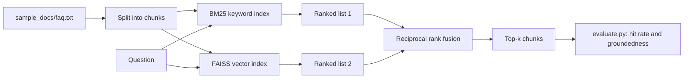

# Project 06: Hybrid Retrieval and Evaluation for RAG

[](https://colab.research.google.com/github/TharunPatel20/GenAI-Engineer/blob/main/projects/06-rag-advanced/notebook.ipynb)

Improve a basic RAG search by combining keyword search (BM25) with vector search, then measure how often the right text is found.

- **Difficulty:** Beginner
- **Estimated time:** 90 to 120 minutes

## Learning Objectives

By the end you will be able to:
- Explain why keyword search and vector search fail on different questions
- Run BM25 keyword search with `rank_bm25`
- Build a FAISS vector index from Gemini embeddings and search it
- Merge two ranked lists with reciprocal rank fusion (RRF)
- Measure retrieval hit rate for keyword, vector, and hybrid search
- Run a simple groundedness heuristic and explain its limits

## Prerequisites

- Python 3.10 or newer (`python --version`)
- A code editor (for example VS Code, free)
- Project 05 completed: [../05-rag-fundamentals/README.md](../05-rag-fundamentals/README.md). This project builds on its chunking, embeddings, and FAISS ideas.
- A Gemini API key from Google AI Studio (free tier). Keyword search works without a key, but vector and hybrid search need one.

## Run in Google Colab

Click the **Open in Colab** badge at the top of this README. Colab opens `notebook.ipynb`. Run the cells top to bottom. Step 0 gets the project files, and the install cell installs the pinned packages from `requirements.txt`. Colab's environment is separate from your computer.

Put your Gemini key in Colab Secrets, not in the code. Click the key icon in the left sidebar, add a secret named `GEMINI_API_KEY`, and turn on notebook access. The BM25 keyword part works without a key. The vector and hybrid search, and the evaluation, need one.

To run on your own computer instead, follow the Setup steps below and use a local `.env` file.

## Setup

1. Open a terminal in this folder.
2. Create and activate a virtual environment.

   Windows (PowerShell):
   ```powershell
   python -m venv .venv
   .venv\Scripts\Activate.ps1
   ```

   macOS or Linux:
   ```bash
   python3 -m venv .venv
   source .venv/bin/activate
   ```

3. Install the pinned packages:
   ```bash
   pip install -r requirements.txt
   ```
4. Copy `.env.example` to `.env`, then paste your key after `GEMINI_API_KEY=`. Never commit `.env`.

## Build Steps

The sample data is `sample_docs/faq.txt`, a short FAQ for a fictional lamp. It contains exact codes such as `ACR-4471` and `LL2-BLK-01`. Keyword search has a real job here.

### Step 1: Split the FAQ into chunks
**What:** `load_chunks()` reads the FAQ and splits it into chunks of up to 300 characters.
**Why:** Retrieval returns chunks, not whole files. Each FAQ entry is short, so a chunk usually holds one or two entries.
**Code:**
```python
from hybrid_retrieval import load_chunks

chunks = load_chunks()
print(len(chunks), "chunks")
print(chunks[0].page_content)
```

### Step 2: Keyword search with BM25
**What:** `keyword_ranking()` scores every chunk with BM25 and returns the chunk ids that share at least one word with the question.
**Why:** BM25 rewards rare, exact words. A code like `ACR-4471` appears in only one chunk, so BM25 finds it. Vector search can miss it, because embeddings capture meaning more than exact strings.
**Code:**
```python
from hybrid_retrieval import HybridRetriever

retriever = HybridRetriever()
for doc in retriever.search("What does order code ACR-4471 include?", mode="keyword"):
    print(doc.page_content[:80])
```

The tokenizer keeps codes such as `acr-4471` as one token. Without that, the code would split into pieces and match too loosely.

### Step 3: Vector search with FAISS and Gemini embeddings
**What:** The first vector search embeds all chunks with `gemini-embedding-001`, stores them in FAISS, and returns the closest chunks.
**Why:** Vectors match on meaning. A question such as "my lamp is dead" can find "try a different outlet" even though the words differ.
**Code:**
```python
for doc in retriever.search("My lamp is dead and nothing happens", mode="vector"):
    print(doc.page_content[:80])
```

The code uses only the order of the results. FAISS returns a distance, and the direction of that distance depends on the index type. Read the [LangChain FAISS documentation](https://python.langchain.com/docs/integrations/vectorstores/faiss/) before you use raw scores.

### Step 4: Hybrid search with reciprocal rank fusion
**What:** `reciprocal_rank_fusion()` takes the BM25 list and the vector list. Each chunk gets `1 / (60 + rank)` from each list, and the scores are added.
**Why:** RRF does not need the two scores to be on the same scale. A chunk that ranks high in both lists rises to the top. A chunk that only one method finds still appears.
**Code:**
```python
for doc in retriever.search("Can I charge it from a battery pack?", mode="hybrid"):
    print(doc.page_content[:80])
```

Hybrid retrieval is the combination from the course recap: keyword search for exact terms, and vector search for meaning. See [recap-2026-11-11.md](../../claude-files/recap-2026-11-11.md).

### Step 5: Rewrite the question (optional)
**What:** `rewrite_query()` asks Gemini to turn the question into a search-friendly query.
**Why:** Users write chatty questions ("hey, how long is the guarantee on this?"). A short keyword query often retrieves better.
**Code:**
```python
from hybrid_retrieval import rewrite_query

print(rewrite_query("hey, how long is the guarantee on this lamp?"))
```

This step is optional and needs a key. It is not used in `evaluate.py` by default. See Exercise 1 below.

### Step 6: Reranking (placeholder)
**What:** `rerank_by_overlap()` re-sorts the results by how many query words each chunk contains.
**Why:** The first search returns candidates. A reranker puts the best candidate first. This placeholder is simple and only shows where a reranker fits. A real reranker is a **cross-encoder**, a model that reads the question and each chunk together and gives one relevance score. Building one is a stretch exercise.
**Code:**
```python
from hybrid_retrieval import rerank_by_overlap

candidates = retriever.search("Is there a student discount?", k=5, mode="hybrid")
for doc in rerank_by_overlap("Is there a student discount?", candidates)[:3]:
    print(doc.page_content[:80])
```

### Step 7: Measure retrieval hit rate
**What:** `evaluate.py` loads `eval_questions.json`. Each question has an `expected_phrase`. For each mode, it checks whether any of the top 3 chunks contains that phrase.
**Why:** You cannot improve retrieval without a way to measure it. Hit rate answers "did the right text come back?" It does not check the final answer.
**Code:** see `evaluate.py`, function `hit()` and the table in `main()`.

### Step 8: Check groundedness with a heuristic
**What:** `groundedness_check()` takes an answer and the retrieved text. It lists the key terms in the answer (long words, codes, and numbers) that are missing from the retrieved text. It flags the answer when less than 80 percent of the key terms are supported.
**Why:** A grounded answer uses words from its sources. An answer with invented details often has terms that are not in the sources.
**Limit:** This is a **simple heuristic, not a full evaluation**. It cannot tell whether a supported word is used correctly, and it misses paraphrases. Use it to spot obvious problems, not to certify answers.

Run the full script with:
```bash
python evaluate.py
```

## Expected Output and Checkpoints

| Checkpoint | What you should see |
|---|---|
| After Step 1 | A chunk count printed (roughly 15 to 25, not checked by running), and text starting with `Q:` |
| After Step 2 | The keyword search returns the chunk that contains `Order code ACR-4471` |
| After Step 3 | Vector search returns the chunk about the dead lamp and the outlet (needs a key) |
| After Step 4 | Hybrid search returns a list that includes the battery pack entry (needs a key) |
| After Step 7 | A table with three rows (keyword, vector, hybrid), each with hits out of 10 |
| After Step 8 | Two groundedness lines, one for each demo answer |

The output below is **illustrative, not captured from a real run**. Your numbers may differ, and they will change if you edit the FAQ or the questions:

```text
Retrieval hit rate (top 3), 10 questions
Mode         Hits   Rate
keyword       8/10   80%
vector        7/10   70%
hybrid        9/10   90%
```

The pattern to look for: keyword search does well on exact codes, vector search does well on paraphrases, and hybrid search is usually at least as good as either one.

## Diagram



## Troubleshooting

| Problem | Likely cause | Fix |
|---|---|---|
| `GEMINI_API_KEY is missing` | `.env` not created, or the key line is empty | Copy `.env.example` to `.env` and paste your key |
| `ModuleNotFoundError: rank_bm25` or `faiss` | Virtual environment not active, or packages not installed | Activate `.venv`, then run `pip install -r requirements.txt` |
| `FileNotFoundError: faq.txt` | The `sample_docs` folder was moved or renamed | Keep `faq.txt` inside `sample_docs/` next to the scripts |
| `404` or `model not found` for an embedding model | The model name changed | Set `GEMINI_EMBED_MODEL` in `.env` to a current name from AI Studio |
| `429` or quota errors | Free-tier limit reached | Wait a minute and run again, or run keyword mode only |
| Keyword search misses a question | The question uses words that are not in the FAQ | Check the FAQ wording. Keyword search needs shared words |
| Evaluation shows `keyword` only | No key set | This is expected. Add the key to measure vector and hybrid |

## Stretch Goals

1. Change `TOP_K` in `evaluate.py` from 3 to 1, then to 5. Record how the hit rate changes.
2. Change `RRF_CONSTANT` in `hybrid_retrieval.py` from 60 to 1, then to 200. Explain what changes.
3. Add a question with no answer in the FAQ. Decide what a good retriever should return, and whether the hit rate can show it.
4. Replace the placeholder reranker with a cross-encoder reranker (for example from `sentence-transformers`). Compare hit rates before and after.

## Exercises

**Exercise 1: Query rewriting.** Write five chatty questions, run each through `rewrite_query()`, then run keyword search on the original and the rewritten query. Did the rewrite help? When could it hurt (hint: it can drop a code)?

**Exercise 2: Groundedness.** Write three answers to the question "What does order code ACR-4471 include?". One should copy the FAQ, one should add a detail the FAQ does not have, and one should be a short refusal ("I could not find that in the FAQ."). Run `groundedness_check()` on each. Which ones were flagged, and which were wrongly flagged?

## What You Learned

- Keyword search (BM25) finds exact words and codes
- Vector search finds meaning and paraphrases
- Reciprocal rank fusion combines two ranked lists without matching their scores
- Hit rate measures whether the right chunk was retrieved
- A groundedness heuristic is a quick check, not a full evaluation

## References

- Course recap, limitations of vanilla RAG and hybrid search: [claude-files/recap-2026-11-11.md](../../claude-files/recap-2026-11-11.md)
- Course recap, hallucination and grounding: [claude-files/recap-2026-11-04.md](../../claude-files/recap-2026-11-04.md)
- Study guide: [AI-Engineer-Guide.md](../../AI-Engineer-Guide.md), section 7 (RAG Architecture: Advanced)
- Previous project: [../05-rag-fundamentals/README.md](../05-rag-fundamentals/README.md)
- Dataset: a synthetic FAQ for a fictional product, written for this course. It is not real data.
