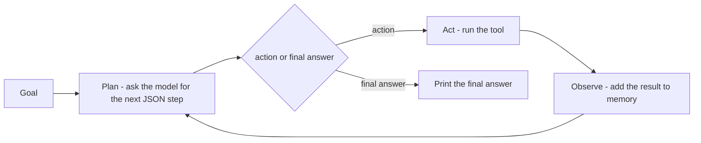
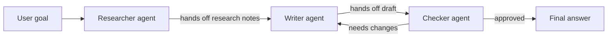

# Project 07: Build a From-Scratch AI Agent Loop

[](https://colab.research.google.com/github/TharunPatel20/GenAI-Engineer/blob/main/projects/07-agentic-ai-intro/notebook.ipynb)

Build a small agent that plans, calls tools, reads the results, and keeps a short memory of what it has done. The agent is a plain Python loop with no agent framework. It uses Google Gemini as its "brain", or a scripted offline stub if you have no key.

- **Difficulty:** Beginner
- **Estimated time:** 90 to 120 minutes

## Learning Objectives

By the end you will be able to:
- Explain the plan, act, observe loop that every AI agent is built around
- Write plain Python functions and register them as tools, using their docstrings as descriptions
- Ask an LLM for a structured JSON reply and parse it safely
- Add a simple memory and a max-step limit to an agent loop
- Explain single-agent versus multi-agent designs, and how this loop differs from a framework such as LangGraph

## Prerequisites

- Python 3.10 or newer (`python --version`)
- A code editor (for example VS Code, free)
- **Project 04 done first.** You should know how to get a free Gemini API key from Google AI Studio and how the `.env` file works. See [../04-prompting-and-peft/README.md](../04-prompting-and-peft/README.md).
- A Gemini API key is optional. Without one, the offline demo runs and shows the loop with scripted replies.

## Run in Google Colab

[](https://colab.research.google.com/github/TharunPatel20/GenAI-Engineer/blob/main/projects/07-agentic-ai-intro/notebook.ipynb)

1. Click the badge. Colab opens `notebook.ipynb` in this folder.
2. Run the cells top to bottom.
3. For live Gemini mode, click the key icon in Colab (**Secrets**), add a secret named `GEMINI_API_KEY`, and turn on **Notebook access**. Never paste the key into a cell.
4. The offline demo works without a key, so you can run the whole loop first.
5. To run on your own computer instead, use the local `.env` file in the Setup section below.

## Setup

1. Open a terminal in this folder.
2. Create and activate a virtual environment.

   Windows (PowerShell):
   ```powershell
   python -m venv .venv
   .venv\Scripts\Activate.ps1
   ```

   macOS or Linux:
   ```bash
   python3 -m venv .venv
   source .venv/bin/activate
   ```

3. Install the pinned packages:
   ```bash
   pip install -r requirements.txt
   ```
4. Optional, for the live Gemini mode: copy `.env.example` to `.env` and paste your key after `GEMINI_API_KEY=`. Never commit `.env` to version control.

## Build Steps

The full program is in `agent_loop.py`, and the tools are in `tools.py`. The steps below explain each part in the order it appears in the code.

### Step 1: Load the key
**What:** Read `GEMINI_API_KEY` from `.env`, the same way project 04 does.
**Why:** Keys belong in a file you do not share, not in your code.
**Code:**
```python
load_dotenv(Path(__file__).with_name(".env"))
MODEL_NAME = "gemini-2.5-flash"
MAX_STEPS = 6
```

### Step 2: Write the tools
**What:** Three plain functions in `tools.py`: `add_numbers`, `get_word_count`, and `lookup_price` (a fake price list). The `TOOLS` dict maps each name to its function.
**Why:** A tool is just a function the agent may ask to run. The docstring is what the model reads to decide when to use it. `describe_tools()` builds that list automatically.
**Code:**
```python
TOOLS = {
    "add_numbers": add_numbers,
    "get_word_count": get_word_count,
    "lookup_price": lookup_price,
}
```

### Step 3: Write the prompt
**What:** The prompt lists the tools, asks for exactly one JSON object, and shows the two allowed forms: `{"action": ..., "args": {...}}` or `{"final_answer": ...}`. It also includes the goal and the memory.
**Why:** A structured reply is easy for code to read. Free text is not.
**Code:**
```python
def build_prompt(goal, memory):
    memory_text = "\n".join(memory) if memory else "(none yet)"
    return PROMPT_TEMPLATE.format(tools=describe_tools(), goal=goal, memory=memory_text)
```

### Step 4: Parse the reply
**What:** Find the JSON object in the model's text and load it. Models sometimes wrap JSON in code fences, so the parser removes those first.
**Why:** The model is not always perfect. Parsing must fail safely.
**Code:**
```python
reply = json.loads(cleaned[start : end + 1])
```

### Step 5: Run the loop (plan, act, observe)
**What:** On each step the code asks the model for the next move. If the reply is a tool call, it runs the tool and stores the result as an observation. The observation is appended to memory, so the next prompt includes it. The loop stops at a `final_answer` or after `MAX_STEPS`.
**Why:** This is the whole idea of an agent. Everything else is detail.
**Code:**
```python
for step in range(1, MAX_STEPS + 1):
    prompt = build_prompt(goal, memory)
    reply_text = ask_model(prompt, step)
    reply = parse_reply(reply_text)
    if "final_answer" in reply:
        return reply["final_answer"]
    observation = f"Result: {TOOLS[action](**args)}"
    memory.append(f"Step {step}: action={action} args={args} -> {observation}")
```

### Step 6: Offline stub and the Gemini call
**What:** `offline_model` returns the next line of `OFFLINE_SCRIPT`. `gemini_reply` calls Gemini with the same `generate_content` pattern as project 04. `main()` chooses between them. If no key is set, it prints a clear note and uses the offline stub.
**Why:** The stub lets you run the whole loop with no account. It is labeled "OFFLINE DEMO" everywhere so you never mistake it for real model output.
**Code:**
```python
if offline:
    ask_model = offline_model
else:
    client = genai.Client(api_key=api_key)
    ask_model = lambda prompt, step: gemini_reply(client, prompt)
```

Run it:
```bash
python agent_loop.py            # live Gemini if GEMINI_API_KEY is set, otherwise the offline demo
python agent_loop.py --offline  # always the offline demo
```

## Expected Output and Checkpoints

The output below is **illustrative, not captured from a real run.** It shows the shape of the output. Your wording may differ, and live Gemini replies will vary.

```
No Gemini API key found, so the offline demo will run.
...
Mode: OFFLINE DEMO: scripted replies, not real Gemini output
Goal: Find the price of a laptop, add 12 and 30, count the words in 'plan act observe', and report all three results.

Step 1 reply: {"action": "lookup_price", "args": {"item": "laptop"}}
  Observation: Result: 999.0

Step 2 reply: {"action": "add_numbers", "args": {"a": 12, "b": 30}}
  Observation: Result: 42.0

Step 3 reply: {"action": "get_word_count", "args": {"text": "plan act observe"}}
  Observation: Result: 3

Step 4 reply: {"final_answer": "The laptop costs 999.0 dollars, 12 + 30 is 42.0, and the phrase has 3 words."}

Final answer: The laptop costs 999.0 dollars, 12 + 30 is 42.0, and the phrase has 3 words.
OFFLINE DEMO: scripted replies, not real Gemini output. The answer is scripted, not produced by a model.
```

| Checkpoint | What you should see |
|---|---|
| After Step 2 | `python -c "from tools import describe_tools; print(describe_tools())"` lists the three tools with their arguments and docstrings |
| After Step 5 | Each step prints a reply and an observation, and memory grows by one line per step |
| After Step 6 (offline) | The `Mode: OFFLINE DEMO` line appears, and the run ends with a final answer in 4 steps |
| After Step 6 (live) | `Model: gemini-2.5-flash` appears, and the agent calls the same tools for its own plan |

## Diagram

The loop in `run_agent`:



## Single-Agent vs Multi-Agent

- **Single agent:** one LLM loop plans, calls every tool, and decides when it is done. This project is a single agent. It is simpler to debug and cheaper to run.
- **Multi-agent:** several agents, each with its own role and often its own tools, pass work to one another. A common pattern is a planner, a worker, and a checker. Use it when one prompt would get too long or mix too many jobs. It costs more calls and needs clear hand-off rules.

Two agents handing work off:



## From-Scratch Loop vs Frameworks

This project writes the loop by hand so you can see every step. Frameworks such as LangGraph, LangChain agents, and AutoGen provide the same loop with extra features: named state, branching graphs, saved progress, streaming, and orchestration between several agents. Those features are valuable, but they hide the loop behind more code. Learn the plain loop first, then use a framework when you need its extras. LangGraph is planned as project 08 and is not in this folder yet.

## Real-World Examples

These are **illustrative examples only**, not descriptions of how any specific product works.

- **Customer support triage:** an agent reads a ticket, calls an order-status tool, and drafts a reply. A person approves any refund before it is sent.
- **Coding assistant:** an agent reads files, runs the tests with a tool, sees the failures as observations, and edits the code again.
- **Travel booking:** an agent calls a flight-search tool, checks the user's dates, and then books or asks a follow-up question (the example in the AI Engineer Guide, section 9).
- **Research assistant:** a search tool finds sources, and a second agent writes the summary. This is a multi-agent split.

## Troubleshooting

| Problem | Likely cause | Fix |
|---|---|---|
| `No Gemini API key found, so the offline demo will run.` | `.env` is missing or still has `your-key-here` | This is expected offline. For live mode, copy `.env.example` to `.env` and paste your key |
| `ModuleNotFoundError: google` or `dotenv` | Virtual environment not active, or packages not installed | Activate `.venv`, then run `pip install -r requirements.txt` |
| `PowerShell cannot run scripts` (Windows) | Execution policy blocks activation | Run `Set-ExecutionPolicy -Scope CurrentUser RemoteSigned`, then activate again |
| `Model call failed:` with a quota or 429 error | Free-tier limit reached | Wait a minute and run again, or check your limits in AI Studio |
| `Error: your reply was not valid JSON` | The model added extra text or broke the JSON | The loop retries on the next step. If it keeps happening, make the prompt stricter |
| `Error: unknown tool 'xyz'` | The model invented a tool name | The observation tells it the valid names. Check that `TOOLS` has the name you expect |
| `No final answer after 6 steps` | The model never gave a `final_answer`, or the goal needs more steps | Raise `MAX_STEPS` or simplify the goal |

## Stretch Goals and Exercises

1. **Add a fourth tool.** Write a function in `tools.py`, for example `convert_currency(amount, rate)`, with a one-line docstring. Add it to `TOOLS`. The prompt picks it up through `describe_tools()` with no other change. Add a matching line to `OFFLINE_SCRIPT` if you want the offline demo to use it.
2. **Add a feedback rule.** The loop already turns a tool error into an observation that starts with `Error:`. Make the rule explicit by adding this line to `PROMPT_TEMPLATE`: "If a step result starts with Error, read it, fix the arguments or pick another tool, and try again." Then add a scripted retry to `OFFLINE_SCRIPT`, for example a `lookup_price` call for `"tablet"` (which fails), followed by a call for `"phone"`. Run the offline demo and check that the agent recovers.
3. **Limit the memory.** Keep only the last three memory lines in `build_prompt`. Explain what the agent might forget and why a long memory costs more tokens.
4. **Two agents on paper.** Describe a planner agent and a worker agent for the same goal. Write which tools each one gets and the exact JSON each one sends to the other. Use the multi-agent diagram above as a starting point.

## What You Learned

- The plan, act, observe loop, and why memory is needed for multi-step work
- Plain Python functions as tools, with docstrings as their descriptions
- Asking an LLM for JSON, and parsing it safely
- Max-step limits and error observations
- Single-agent versus multi-agent designs, and the trade-offs of frameworks

## References

- Course recap: [../../claude-files/recap-2026-11-11.md](../../claude-files/recap-2026-11-11.md) (the agents preview: reinforcement learning agents versus AI agents, the LLM as the reasoning brain, tools, and code-based versus no-code tools)
- Study guide: [../../AI-Engineer-Guide.md](../../AI-Engineer-Guide.md), section 9 (Agentic AI: Introduction)
- Previous project: [../04-prompting-and-peft/README.md](../04-prompting-and-peft/README.md) (Gemini key and `.env` pattern)
- Model names and free-tier limits change. Check Google AI Studio before you run live mode.
