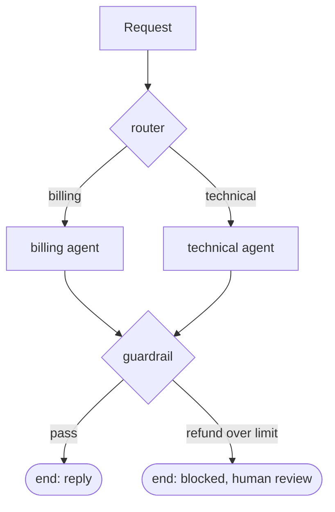

# Project 08: Route Requests with a LangGraph Agent Graph

[](https://colab.research.google.com/github/TharunPatel20/GenAI-Engineer/blob/main/projects/08-langgraph-agents-mcp/notebook.ipynb)

Build a small LangGraph graph that routes a customer request to a "billing" or "technical" specialist, then passes the answer through a guardrail that blocks large refunds. The graph is the framework version of the loop you wrote by hand in project 07. It runs fully offline, and it uses Google Gemini only when a key is set and the keyword rules cannot decide.

- **Difficulty:** Beginner
- **Estimated time:** 90 to 120 minutes (the MCP stretch adds 60 minutes)

## Learning Objectives

By the end you will be able to:
- Describe a graph of steps (nodes and edges) and explain why it helps with multi-agent work
- Define a typed state with `TypedDict` and write nodes that return only the keys they change
- Add conditional edges that route on a value in the state
- Add a guardrail node that can stop an answer before it reaches the user
- Log each node's name and state keys, so you can check what the graph did
- Explain what MCP (Model Context Protocol) is, and what it takes to expose one tool through it (stretch)

## Prerequisites

- Python 3.10 or newer (`python --version`)
- A code editor (for example VS Code, free)
- **Project 07 done first.** You should understand the plan, act, observe loop and the tool-as-function pattern. See [../07-agentic-ai-intro/README.md](../07-agentic-ai-intro/README.md).
- **Project 04 done first.** You should know how to get a free Gemini API key and how the `.env` file works. See [../04-prompting-and-peft/README.md](../04-prompting-and-peft/README.md).
- A Gemini API key is optional. Without one, the graph runs with keyword routing only.

## Run in Google Colab

Click the **Open in Colab** badge at the top of this page, then run the notebook cells top to bottom. Keyword routing works without a key, so the main graph runs with no setup. To use the optional Gemini fallback, add `GEMINI_API_KEY` in Colab Secrets (key icon in the left sidebar, with notebook access on).

The MCP stretch section is local-only. It needs a terminal and `requirements-mcp.txt`, so it is not run in Colab. To run the whole project on your own computer, use a local `.env` file instead, as described in Setup below.

## Setup

1. Open a terminal in this folder.
2. Create and activate a virtual environment.

   Windows (PowerShell):
   ```powershell
   python -m venv .venv
   .venv\Scripts\Activate.ps1
   ```

   macOS or Linux:
   ```bash
   python3 -m venv .venv
   source .venv/bin/activate
   ```

3. Install the pinned packages:
   ```bash
   pip install -r requirements.txt
   ```
4. Optional, for the live Gemini fallback: copy `.env.example` to `.env` and paste your key after `GEMINI_API_KEY=`. Never commit `.env` to version control. The MCP stretch needs a separate install, described in its section.

## Build Steps

The full program is in `router_graph.py`. The steps below explain each part in the order it appears in the code.

### Step 1: Load the key
**What:** Read `GEMINI_API_KEY` from `.env`, the same way projects 04 and 07 do.
**Why:** Keys belong in a file you do not share. The key is optional, so the graph still runs without it.
**Code:**
```python
load_dotenv(Path(__file__).with_name(".env"))
MODEL_NAME = "gemini-2.5-flash"
REFUND_LIMIT = 100.0
```

### Step 2: Define the typed state
**What:** A `TypedDict` named `RouterState` lists the four keys every node can see: `request`, `category`, `reply`, and `blocked`.
**Why:** A typed state is the shared memory of a graph. Each node reads the state and returns only the keys it changes. LangGraph merges those keys into the state for the next node.
**Code:**
```python
class RouterState(TypedDict):
    request: str
    category: str
    reply: str
    blocked: bool
```

### Step 3: The router, with keyword rules first
**What:** `keyword_category` counts billing words and technical words in the request. The category with more matches wins. A tie returns `None`.
**Why:** Keyword rules are fast, free, and work offline. Use them before any model call.
**Code:**
```python
billing = sum(1 for word in BILLING_WORDS if re.search(rf"\b{re.escape(word)}\b", lowered))
technical = sum(1 for word in TECHNICAL_WORDS if re.search(rf"\b{re.escape(word)}\b", lowered))
```

### Step 4: The optional LLM fallback
**What:** If the keywords do not decide, and `GEMINI_API_KEY` is set, `llm_category` asks `gemini-2.5-flash` to answer with one word. If the call fails, the router logs a warning and uses the default, `technical`.
**Why:** A model can handle requests that use no keywords. The fallback is only used when needed, so most runs make no model call.
**Code:**
```python
llm = ChatGoogleGenerativeAI(model=MODEL_NAME, google_api_key=os.environ["GEMINI_API_KEY"], temperature=0)
answer = str(llm.invoke(prompt).content).strip().lower()
```

### Step 5: Specialists and the guardrail
**What:** `billing_agent` and `technical_agent` return canned replies. `guardrail_node` looks for a sentence of the form "refund $X" in the reply. If X is over `REFUND_LIMIT` (100), it replaces the reply with a blocked message and sets `blocked` to `True`.
**Why:** A guardrail is a rule that checks an answer before it leaves the system. Here the rule is a simple pattern check. Real guardrails can use policy engines, classifiers, or a human review step.
**Code:**
```python
if match and float(match.group(1)) > REFUND_LIMIT:
    return {"reply": blocked_reply, "blocked": True}
return {"blocked": False}
```

### Step 6: Wire the graph
**What:** Add the four nodes, set `router` as the entry point, add a conditional edge from `router` to `billing` or `technical`, add edges from both specialists to `guardrail`, and end after the guardrail.
**Why:** The edges are the control flow. Reading them tells you every path a request can take.
**Code:**
```python
graph.add_conditional_edges("router", route_by_category, {"billing": "billing", "technical": "technical"})
graph.add_edge("billing", "guardrail")
graph.add_edge("technical", "guardrail")
graph.add_edge("guardrail", END)
return graph.compile()
```

### Step 7: Invoke it
**What:** `main()` builds the graph and runs two example requests with `app.invoke`.
**Why:** `invoke` takes an initial state and returns the final state. You read the answer from the result.

Run it:
```bash
python router_graph.py            # keyword routing, plus Gemini fallback if a key is set
python router_graph.py --offline  # keyword routing only, no network calls
```

## Observability: Logging Each Node

Every node is wrapped by `traced()`, which uses Python `logging` to write two lines per node:
- on entry, the node name and the **keys** of the state
- on exit, the node name and the **keys** the node returned

The log records keys, not values. That keeps customer text out of the logs. To see what a node decided, read its own log line, such as `router chose billing via keywords`.

Why this matters: when a graph has several branches, a log of the path (`router -> billing -> guardrail`) is the fastest way to see which branch ran and why. Later projects in the course use tracing tools for the same job. The idea is the same.

## Expected Output and Checkpoints

The output below is **illustrative, not captured from a real run.** The wording and the exact log order may differ on your machine.

```
Mode: OFFLINE keyword routing only (no network calls)
INFO router_graph: enter node=router state_keys=['blocked', 'category', 'reply', 'request']
INFO router_graph: router chose billing via keywords
INFO router_graph: exit node=router updated_keys=['category']
INFO router_graph: enter node=billing state_keys=['blocked', 'category', 'reply', 'request']
INFO router_graph: exit node=billing updated_keys=['reply']
INFO router_graph: enter node=guardrail state_keys=['blocked', 'category', 'reply', 'request']
INFO router_graph: exit node=guardrail updated_keys=['blocked', 'reply']

Request: I was charged $250 twice, please refund the payment.
Category: billing  Blocked: True
Reply: Blocked by guardrail: refunds over $100 need a human agent. A person will review this request.

INFO router_graph: enter node=router ...
INFO router_graph: router chose technical via keywords
...
Request: The app shows an error when I try to log in.
Category: technical  Blocked: False
Reply: Please clear your browser cache, then try logging in again. If the error continues, send us the error text.
```

| Checkpoint | What you should see |
|---|---|
| After Step 3 | `python -c "from router_graph import keyword_category as k; print(k('I need a refund'), k('app error'), k('hello'))"` prints `billing technical None` |
| After Step 5 | A refund of $250 is blocked. A short billing question with no amount is not |
| After Step 6 | Each request prints one `Category` line and one `Reply` line |
| After Step 7 | Each node writes an `enter` and an `exit` log line |

## Diagram

The graph in `build_graph()`:



## Troubleshooting

| Problem | Likely cause | Fix |
|---|---|---|
| `ModuleNotFoundError: langgraph` or `langchain_google_genai` | Virtual environment not active, or packages not installed | Activate `.venv`, then run `pip install -r requirements.txt` |
| `PowerShell cannot run scripts` (Windows) | Execution policy blocks activation | Run `Set-ExecutionPolicy -Scope CurrentUser RemoteSigned`, then activate again |
| `LLM routing failed (...)` warning | Key is wrong, quota is used up, or no network | The graph uses the default category. Check the key, or run with `--offline` |
| Every request goes to `technical` | No keyword matched, and no key is set | Add a keyword to `BILLING_WORDS` or `TECHNICAL_WORDS`, or set a key for the fallback |
| A state key error after editing | A node returns a key that is not in `RouterState`, often a spelling mistake | Check the key name against `RouterState`, or add the key to it |

## Stretch Goals

1. Add a third specialist, `refund_review`, that the router picks for any request containing the word "appeal". Add the edge and the edge to `guardrail`.
2. Change `REFUND_LIMIT` to 50 and rerun. Explain which example changes and why.
3. Add a request with no keywords, such as "Can you help me with my account?". Run it with a key and without one. Compare the category and the log line.
4. Write one new node that rejects empty requests and routes them to `END` through a conditional edge.

## STRETCH: MCP (Model Context Protocol)

**This section is optional. Skip it if you are short on time.**

**What MCP is.** MCP (Model Context Protocol) is an open standard for how an AI application connects to tools and data. A server publishes a list of tools with names, descriptions, and input schemas. A client, such as an agent, asks the server what tools exist and calls them. The point is that a tool written once for MCP can be used by any MCP-aware client, without rewriting the agent.

**How it relates to this project.** In `tools.py` of project 07, a tool is a Python function in the same program. With MCP, the tool runs in a separate server process, and the agent calls it over the protocol. The graph in this project could call such a tool from a node in the same way it calls the specialists.

**Exercise (instructions only, not required):**

1. Install the optional packages in a separate step, so the main project is not affected:
   ```bash
   pip install -r requirements-mcp.txt
   ```
2. Read the official Python MCP SDK documentation for the server API. Find the decorator that registers a function as a tool, and the function that starts a server over stdio.
3. Create a new file, `mcp_server.py`, in this folder. Register one tool, for example `lookup_refund_limit()`, that returns the value of `REFUND_LIMIT`. Use a docstring as its description, the same way project 07 does.
4. Start the server with the SDK's standard run function, using the stdio transport. Use an MCP inspector tool from the SDK documentation, if one is listed there, to see the tool and call it.
5. Write three sentences in your notes. Say what the server exposes, what a client would send and receive, and why a team might keep tools in a separate server.

The MCP SDK version is pinned in `requirements-mcp.txt` and is not confirmed. Check the SDK documentation for the current API before you start.

## Further Reading (concept only, not in this project)

- **Graph databases:** These store entities and the links between them, such as customers, orders, and products. A graph database can give an agent facts that it looks up by relationship, which helps ground answers. This project does not use one. The next step would be a graph database for knowledge grounding, as an alternative to a vector store.
- **CrewAI:** A framework for teams of role-based agents, where each agent has a role, a goal, and tools. It is a different style from LangGraph. LangGraph uses explicit graphs of steps, and CrewAI uses named roles and tasks. This project does not use CrewAI.
- **Reinforcement learning for decisions:** An agent can learn which action to take by receiving a reward for good outcomes. You met the idea in the agents preview of the course recap. This project uses fixed rules, not learned ones.

## What You Learned

- A graph of nodes and edges, with a typed state shared by every node
- Keyword routing first, with an optional model fallback
- Conditional edges that send a request to one branch
- A guardrail node that checks an answer before it is returned
- Logging node names and state keys to see the path a request took
- What MCP is, and the steps to expose one tool through it (stretch)

## References

- Course recap: [../../claude-files/recap-2026-11-11.md](../../claude-files/recap-2026-11-11.md) (the agents preview, and why LangGraph suits multi-agent orchestration better than plain LangChain agents)
- Study guide: [../../AI-Engineer-Guide.md](../../AI-Engineer-Guide.md), section 10 (Agentic AI and Future Directions: LangGraph, MCP, guardrails, observability)
- Previous project: [../07-agentic-ai-intro/README.md](../07-agentic-ai-intro/README.md) (the from-scratch agent loop this project builds on)
- Key setup: [../04-prompting-and-peft/README.md](../04-prompting-and-peft/README.md)
- Model names, free-tier limits, and library versions change. Check Google AI Studio and the LangGraph documentation before you run live mode.
