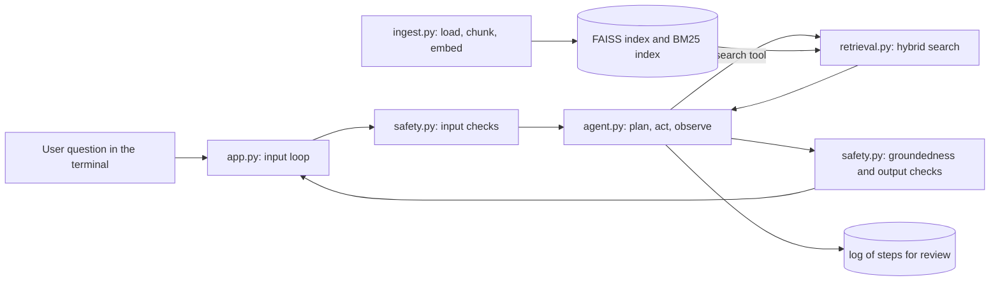
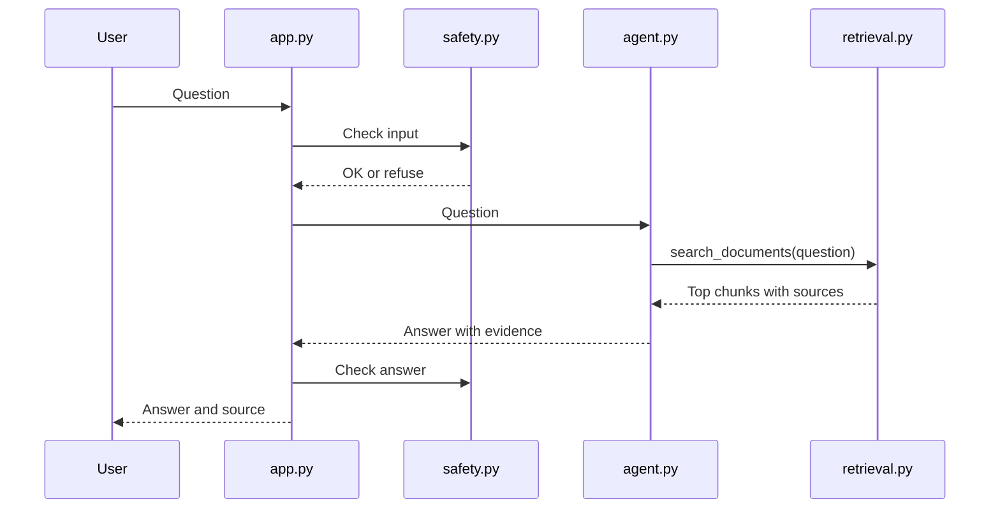

# Project 09: Final AI Application (Scoped Template)

[](https://colab.research.google.com/github/TharunPatel20/GenAI-Engineer/blob/main/projects/09-final-ai-application/notebook.ipynb)

Build one complete, small AI application that combines the earlier projects: a document search (RAG), a measured retrieval check, an agent that uses the search as a tool, a simple interface, and a written safety review. Then present it.

This is a **scoped template**, not a finished app. The folder holds the plan, the requirements, and empty skeleton files. The working code for each part lives in projects 05 to 07, and this project points you back to them instead of copying it.

- **Difficulty:** Beginner (capstone)
- **Estimated time:** 6 to 10 hours over several sessions, plus a 10 to 15 minute presentation

## Learning Objectives

By the end you will be able to:
- Define a use case, its users, and what "good enough" means before writing code
- Build a RAG index from your own documents and reuse the chunking and FAISS pattern from project 05
- Measure retrieval quality with a hit rate, using the idea from project 06
- Give an agent a search tool and a step limit, using the loop from project 07
- Wrap the app in a simple interface and add guardrails
- Review the app for safety and fairness, and explain its limits to a non-technical audience

## Prerequisites

- Python 3.10 or newer (`python --version`)
- A code editor (for example VS Code, free)
- Projects 05, 06, and 07 completed. They are the building blocks for this project:
  - [../05-rag-fundamentals/README.md](../05-rag-fundamentals/README.md) (RAG pipeline)
  - [../06-rag-advanced/README.md](../06-rag-advanced/README.md) (hybrid retrieval and evaluation)
  - [../07-agentic-ai-intro/README.md](../07-agentic-ai-intro/README.md) (agent loop and tools)
- A Gemini API key from Google AI Studio (free tier). Go to aistudio.google.com and choose "Get API key". The same key is used in projects 04 to 07.

## Run in Google Colab

This notebook sets up the environment and checks the skeleton in `app_skeleton/`. The real build happens milestone by milestone, in the notebooks of projects 05 to 08. Add your Gemini key with Colab Secrets (named `GEMINI_API_KEY`). A local `.env` file is the alternative if you run the project on your own computer.

## Setup

1. Open a terminal in this folder.
2. Create and activate a virtual environment.

   Windows (PowerShell):
   ```powershell
   python -m venv .venv
   .venv\Scripts\Activate.ps1
   ```

   macOS or Linux:
   ```bash
   python3 -m venv .venv
   source .venv/bin/activate
   ```

3. Install the starter packages:
   ```bash
   pip install -r requirements.txt
   ```
   This file is a **minimal starter**. It holds only `python-dotenv`, which the config file needs. You add the rest yourself, using the pins from the earlier projects:
   - From project 05: LangChain, FAISS, and the Gemini packages. Copy the lines from `../05-rag-fundamentals/requirements.txt` into a new file, or install them with `pip install -r ../05-rag-fundamentals/requirements.txt`.
   - From project 06: `rank-bm25==0.2.2` for keyword search.
   - From project 07: `google-genai==2.34.0` for the agent's model calls.

   Add these in M2 and M4, not all at once. Check each line for version clashes before you install (see Troubleshooting).

4. Create your `.env` file from the template, then paste your key after `GEMINI_API_KEY=`.

   Windows (PowerShell):
   ```powershell
   cp .env.example .env
   ```

   macOS or Linux:
   ```bash
   cp .env.example .env
   ```

**Keep your key private.** Never commit `.env`. The `faiss_index/` folder and the `data/` folder are generated or copied from your own files, so do not commit them either.

## Architecture



Suggested reading order: `config.py`, then `ingest.py`, then `retrieval.py`, then `agent.py`, then `safety.py`, then `app.py`.

## Build Steps

Each milestone reuses an earlier project. Finish one milestone, check its "Done when" line, then move on. The skeleton files in `app_skeleton/` have a TODO for each milestone.

### M1: Define the use case and the users
**What:** Write a one-page use case. Name the users, the question they ask, the documents the app may use, and what the app must never do.
**Why:** Every later choice depends on this. A clear use case is also the first part of the safety review in M6.
**Reuses:** [AI-Engineer-Guide.md](../../AI-Engineer-Guide.md), section 12 (use-case outline: problem, data, approach, risks).
**Write down:**
- Users: who they are and what they already know
- Question types: three example questions and three you will refuse
- Data: which files you will index, who owns them, and whether they contain personal data
- Success: the minimum hit rate and the minimum number of answers that you can check against a source
**Done when:** A one-page use case exists in your notes (not in this folder), and you can explain it in two sentences.

### M2: Data and RAG index (reuse project 05)
**What:** Put your documents in a `data/` folder, then build a FAISS index with `ingest.py`. Add the project 05 packages to `requirements.txt` first.
**Why:** The index is what lets the app answer from your documents. Chunking, embeddings, and FAISS work the same way as in project 05.
**Reuses:** [../05-rag-fundamentals/build_index.py](../05-rag-fundamentals/build_index.py) (steps 1 to 3: load, chunk at 1000 with 100 overlap, embed, save) and [../05-rag-fundamentals/ask_rag.py](../05-rag-fundamentals/ask_rag.py) (steps 4 and 5).
**Start with:** copy `../05-rag-fundamentals/sample_docs/company_notes.txt` into `data/` so you have something to test with. Replace it with your own documents later.
**Done when:** `faiss_index/` is created by the build step, and a test question returns a chunk that matches the source text.

### M3: Retrieval quality checks (reuse project 06)
**What:** Write 10 questions with the phrase each answer must contain (an `expected_phrase`, as in project 06). Measure the hit rate, meaning the share of questions where the top 3 chunks contain the phrase. Compare keyword, vector, and hybrid search.
**Why:** If retrieval misses the right text, the answer will be wrong whatever the model does. You cannot improve what you do not measure.
**Reuses:** [../06-rag-advanced/evaluate.py](../06-rag-advanced/evaluate.py) and [../06-rag-advanced/eval_questions.json](../06-rag-advanced/eval_questions.json) (the hit-rate table), and [../06-rag-advanced/hybrid_retrieval.py](../06-rag-advanced/hybrid_retrieval.py) (BM25 plus FAISS with reciprocal rank fusion).
**Note:** project 06 has a groundedness heuristic (its Step 8). It is a rough check only. Do not treat it as proof that an answer is correct.
**Done when:** You have a table with three rows (keyword, vector, hybrid) and a hit count out of 10 for each. Write the numbers down, because you will present them.

### M4: Agent that uses the retriever (reuse project 07)
**What:** Give the agent a `search_documents` tool that calls the retriever from M3. Keep the plan, act, observe loop, the JSON reply, and the `MAX_STEPS` limit from project 07.
**Why:** An agent decides when to search and what to do with the result. The step limit stops a loop from running forever.
**Reuses:** [../07-agentic-ai-intro/agent_loop.py](../07-agentic-ai-intro/agent_loop.py) (the loop) and [../07-agentic-ai-intro/tools.py](../07-agentic-ai-intro/tools.py) (tools as plain functions with docstrings).
**Note on the pattern:** the earlier plan named project 08 (LangGraph routing) for this step. That folder is **not present** in this repository, so this template uses project 07's plain loop. If you have a LangGraph version, you can swap it in, but it is not required.
**Done when:** A question that needs a document search gets a grounded answer with the source passage quoted, and the agent stops within `MAX_STEPS`.

### M5: Simple interface
**What:** Run the app in a terminal loop. The user types a question, the app shows the answer and its evidence, and the user types `quit` to stop.
**Why:** A command-line loop is the simplest interface. It needs no extra packages, so there are no new pins to check. A web interface such as Streamlit is a fine upgrade, but it adds a dependency and a version to pin. Choose it only when you can test the pin, and note that choice in your write-up.
**Reuses:** the input loop pattern from project 07's `agent_loop.py` `main()`.
**Done when:** `python app_skeleton/app.py` starts, takes at least three questions in a row, and exits on `quit`.

### M6: Safety and fairness review
**What:** Answer the questions below, then add the checks to `safety.py`.
**Why:** A working app can still be unsafe or unfair. This step is where you find out.
**Reuses:** [AI-Engineer-Guide.md](../../AI-Engineer-Guide.md), section 12 (safety, fairness, transparency, use-case outline) and section 11 (risk management, bias, explainability).

Questions to answer in writing:
1. **Safety:** What harmful or wrong output could the app give? What happens when the answer is not in the documents? Does it say "I don't know"?
2. **Grounding:** Does every answer show the source passage it came from? Can a user check it?
3. **Privacy:** Do any documents contain personal data? Does the app print, store, or log it? Remove personal data from the documents you index.
4. **Fairness:** If the documents describe people or groups, are answers the same for each group? Write three paired questions that differ only in the group named, and compare the answers.
5. **Transparency:** Can a user tell that an answer came from a model and from which documents?
6. **Misuse:** Could someone use the app to get around a rule in the documents, or to extract the whole index?
7. **Limits:** What is the app not good for? Write this in plain words for the presentation.

Checks to add to `safety.py` (listed as TODOs in the skeleton):
- Reject empty or very long questions
- Refuse questions outside the use case from M1
- Block requests for personal identifiers and sensitive data, such as Social Security numbers, Aadhaar, PAN, passport or driver's license numbers, credit card numbers, and patient records. The organization policy for this course forbids requesting, storing, processing, or displaying them.
- Run the groundedness heuristic on each answer and flag weak ones
- Cap the agent's steps (project 07, `MAX_STEPS`)
- Require a person to review any action that changes data (the agent in this project should only read)

**Done when:** The seven questions have written answers, and at least two checks are implemented in `safety.py` and shown to work with one test question each.

### M7: Demo and short write-up
**What:** Run a live demo with three questions you prepared: one answered well, one that must be refused or answered "I don't know", and one that shows a limit. Write a one-page summary: use case, architecture, metrics from M3, safety findings from M6, and the next step.
**Why:** The final project is judged by a demo and by your explanation of the trade-offs.
**Done when:** The demo runs from a clean terminal, and the write-up contains the M3 numbers and the M6 risk note.

## Definition of Done

Your project is done when all of these are true:
- [ ] The app starts from a terminal and answers at least three questions in a row
- [ ] Each answer that uses a document shows the source passage (grounded answers with evidence)
- [ ] The app says "I don't know" when the answer is not in the documents
- [ ] At least one guardrail in `safety.py` runs and has been tested
- [ ] The M3 table has hit counts for keyword, vector, and hybrid search
- [ ] The M6 risk note is written, including what the app must not be used for
- [ ] `.env`, `faiss_index/`, and `data/` are not committed to version control

## Rubric

Score each line from 0 (missing) to 2 (complete). Total: 20 points.

| Criterion | 0 | 1 | 2 |
|---|---|---|---|
| Works end to end | Parts run separately, or not at all | Runs with manual steps between parts | One command starts the app, and it answers questions |
| Grounded answers with evidence | No sources shown | Some answers show sources | Every document-based answer quotes its source |
| At least one guardrail | None | One guardrail, not tested | Two or more guardrails, each shown to work |
| Evaluation numbers | No measurement | Hit rate for one mode | Hit rate for three modes, with the questions listed |
| Written risk note | Missing | Lists risks with no safeguards | Risks, safeguards, and limits, using the M6 questions |
| Clear use case | Vague | Users named, no success measure | Users, questions, data, and a success measure |
| Presentation | Cannot explain choices | Explains the what, not the why | Explains the trade-offs and answers questions |

Score 14 or more, with every criterion at 1 or higher, to pass.

## Presentation Outline

Plan for 10 to 15 minutes, then 5 minutes of questions.

1. **Problem and users (1 min):** the use case from M1
2. **Architecture (2 min):** the diagram above, one sentence per box
3. **Live demo (3 min):** the three prepared questions from M7
4. **Evaluation (2 min):** the M3 table, and what it showed
5. **Safety and fairness (3 min):** two risks, their safeguards, and one thing the app must not do
6. **Limits and next steps (1 min):** what you would build next
7. **Questions (5 min):** be ready to show the source of any answer

## Diagram

The architecture diagram is in the [Architecture](#architecture) section above. The data flow for one question:



## Expected Output and Checkpoints

The skeleton prints only one line. Your finished app will print more, and the exact wording will differ.

```text
Replace me with your app
```

| Checkpoint | What you should see |
|---|---|
| After M1 | A one-page use case in your notes, not in this folder |
| After M2 | `faiss_index/` exists, and a test question returns a chunk from your data |
| After M3 | A table with three rows and a hit count out of 10 for each |
| After M4 | An answer with a quoted source, and the agent stops within `MAX_STEPS` |
| After M5 | The app takes three questions and exits on `quit` |
| After M6 | The seven written answers, and at least two checks in `safety.py` that you tested |
| After M7 | A clean demo run and a one-page write-up with the M3 numbers and the M6 risk note |

## Troubleshooting

| Problem | Likely cause | Fix |
|---|---|---|
| `ModuleNotFoundError: dotenv` | Virtual environment not active, or packages not installed | Activate `.venv`, then run `pip install -r requirements.txt` |
| `ModuleNotFoundError: langchain_community` (or another package from project 05) | You have not added the project 05 packages yet (M2) | Add them, then run `pip install -r requirements.txt` again |
| Version clash between project 05 and project 07 pins | Two projects pin different versions of a shared package | Check the lines in each `requirements.txt`, choose one version that both projects can use, and test it. Do not assume the combined pins work |
| `No index found` | You started the app before M2 built the index | Run the build step from M2 first |
| `FileNotFoundError` for a file in `data/` | The `data/` folder is missing or the file moved | Create `data/` and copy your documents into it |
| `GEMINI_API_KEY is missing` | `.env` not created, or the key line is empty | Run `cp .env.example .env` and paste your key |
| `429` or quota errors | Free-tier limit reached | Wait a minute and retry. Ask fewer questions in a row |
| The agent never finishes | The model keeps calling tools | Check `MAX_STEPS` in `config.py`, and read the step log |
| `PowerShell cannot run scripts` (Windows) | Execution policy blocks activation | Run `Set-ExecutionPolicy -Scope CurrentUser RemoteSigned`, then activate again |

## Stretch Goals

These are options, not required. Describe your choice in the write-up. Do not create accounts for any of them as part of this course.

1. **Multi-user access.** Let several people ask questions, each with their own history. Decide what each user may see. Options to research: user IDs stored with each log line, or a login step in front of the interface. Note the privacy risks.
2. **Logging dashboard.** Save each question, the retrieved sources, and the answer to a log file, then count questions per day and the share of "I don't know" answers. A small chart from the log is enough. Use the chart patterns from project 01 (Matplotlib) for this.
3. **A second data source.** Add a second folder of documents, such as a PDF or a web page, using a different loader from project 05's loader notes. Check whether hit rate changes on the M3 questions.
4. **Deploying.** Describe these options only, with pros and cons. Do not sign up for any service.
   - Keep it local, and share the code and a recorded demo
   - Package the app in a container image, so it runs the same on any machine
   - Put the app behind a simple web framework, and run it on a hosting platform that your organization approves
   - Share a notebook that runs the pipeline step by step

## What You Learned

- Writing a use case before writing code
- Building a RAG index from your own documents
- Measuring retrieval with a hit rate, and comparing search methods
- Giving an agent a tool and a step limit
- Adding guardrails and writing a safety and fairness review
- Presenting a technical project with its limits

## References

- Study guide: [AI-Engineer-Guide.md](../../AI-Engineer-Guide.md), section 13 (final showcase), section 12 (safety, fairness, use cases), and section 11 (risk and governance)
- Course recap, RAG and agents: [claude-files/recap-2026-11-11.md](../../claude-files/recap-2026-11-11.md)
- Project 05: [../05-rag-fundamentals/README.md](../05-rag-fundamentals/README.md)
- Project 06: [../06-rag-advanced/README.md](../06-rag-advanced/README.md)
- Project 07: [../07-agentic-ai-intro/README.md](../07-agentic-ai-intro/README.md)
- Sample document: `../05-rag-fundamentals/sample_docs/company_notes.txt` is a fictional company written for this exercise. It is not real data.
